# exactfig

**Figuras, animaciones y sonificaciones reproducibles a partir de datos y de matemática publicada, verificables bit a bit.**

[Read in English](README.md)

exactfig convierte una pequeña *receta* JSON (un generador, sus parámetros, una semilla y, para datos, un fichero de entrada
fijado por su huella) en una imagen, una animación o un fichero MIDI, y apunta en un *manifiesto* todo lo necesario para
reproducirlo. `exactfig verify` vuelve a ejecutar cada receta y compara el resultado con el fichero en disco, **píxel a píxel,
fotograma a fotograma, byte a byte**, en cualquier máquina. Es Python puro, sin dependencias.

Está pensado para ingenieros e investigadores que necesitan una figura que cualquiera pueda regenerar y comprobar: una
reconstrucción a partir de medidas dispersas, un modelo de elevación sombreado, la evolución de un autómata celular, un
experimento de óptica de ondas, un sistema dinámico. La figura, sus datos y el código que la dibujó quedan atados por hashes;
publicar un solo valor (`manifest_sha256`) fija el conjunto entero.

| | | |
|---|---|---|
| 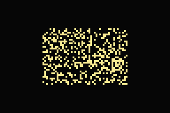 | 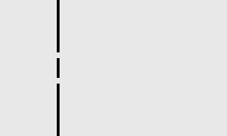 | 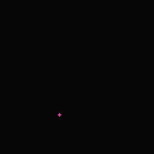 |
| La Vida de Conway desde una sopa con semilla, células coloreadas por edad | La ecuación de ondas a través de una doble rendija (leapfrog, borde absorbente) | El atractor de Lorenz, Runge–Kutta 4 |
| 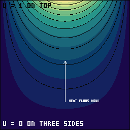 | 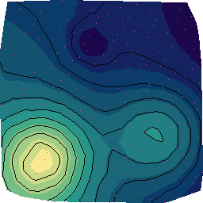 | 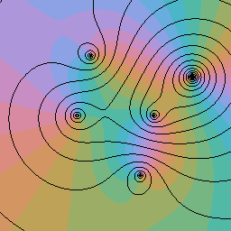 |
| Una figura por capas: solución exacta de Laplace, curvas de nivel y anotaciones | La función de Franke a partir de 256 muestras dispersas (Delaunay exacto) | Retrato de fase de una función compleja con líneas de módulo |

## Contenido

- [Qué se garantiza](#qué-se-garantiza)
- [Inicio rápido](#inicio-rápido)
- [Galería](#galería)
- [Usarlo para investigar](#usarlo-para-investigar)
- [Recetas: semillas, paletas, parámetros, edición](#recetas-semillas-paletas-parámetros-edición)
- [Tus propios datos](#tus-propios-datos)
- [Animaciones y vídeo](#animaciones-y-vídeo)
- [Capas y edición](#capas-y-edición)
- [Lean](#lean)
- [Conversión de imágenes](#conversión-de-imágenes)
- [Matemáticas por área](#matemáticas-por-área)
- [Verificación](#verificación)
- [API de Python](#api-de-python)
- [Reproducibilidad numérica](#reproducibilidad-numérica)
- [Límites](#límites)
- [Arquitectura](#arquitectura)
- [Referencias](#referencias)

## Qué se garantiza

| Afirmación | Cómo se comprueba |
|---|---|
| El fichero es exactamente lo que calcula la receta | `verify` vuelve a ejecutarla y compara los píxeles decodificados (cada fotograma de una animación) o los bytes MIDI |
| Los datos de entrada son los que se apuntaron | la receta fija cada fichero por su SHA-256; un byte cambiado hace fallar `verify`, que nombra el fichero |
| El código es el que se apuntó | cada entrada guarda un hash del código del generador; un cambio es un aviso, y un fallo con `--strict` |
| Los colores son de una paleta declarada | los generadores dibujan *índices* de paleta; `verify` comprueba cada píxel opaco contra la paleta apuntada |
| Los mismos bits en cualquier plataforma | las funciones trascendentes salen de `exactfig.fmath` (solo aritmética básica IEEE 754); comprobado en x86-64 y ARM64 |
| El conjunto entero queda fijado | `manifest_sha256` cubre todas las entradas: basta con firmar o publicar ese valor |
| Una receta no puede colar una imagen | esquemas de parámetros cerrados (valores con tipo y rango, nada de matrices de píxeles); los datos solo entran como un fichero con nombre y hash |

Lo que no prueba: quién escribió el código o eligió la receta (para eso, firma el resumen del manifiesto), ni que un modelo o
unos datos sean correctos. Prueba que *esta salida es lo que este código calcula a partir de estas entradas*.

## Inicio rápido

Hace falta Python 3.10 o posterior. No hay nada que instalar.

```sh
python -m exactfig selftest                                # ¿esta máquina reproduce exactfig bit a bit? (segundos)
python -m exactfig list                                    # generadores y sus esquemas de parámetros
python -m exactfig verify --manifest gallery/manifest.json --strict
python -m exactfig render examples/recipes/franke-linear.json --data-dir gallery --out-dir out
python -m unittest discover tests
```

`pip install -e .` también instala la orden `exactfig`.

## Galería

Cada fichero sale de una receta de [`examples/recipes`](examples/recipes) y está apuntado en
[`gallery/manifest.json`](gallery/manifest.json). Las pruebas los verifican todos.

### Datos

| | | |
|---|---|---|
| 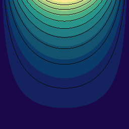 |  | 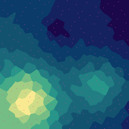 |
| Temperatura estacionaria de una placa, la solución exacta de la ecuación de Laplace (`.npy`), curvas cada 0,1 | La función de Franke a partir de 256 muestras de Halton (CSV), interpolación lineal sobre Delaunay, con las muestras marcadas | Las mismas muestras, reconstrucción por la muestra más cercana (celdas de Voronoi) |
| 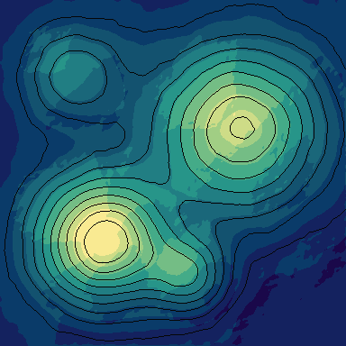 | 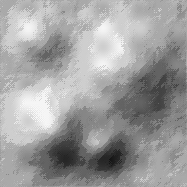 | 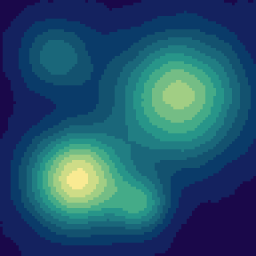 |
| Modelo de elevación (PGM de 16 bits, celdas de 60 m): tinte hipsométrico con sombreado y curvas cada 200 m | Solo el sombreado (gradiente de Horn, luz del noroeste a 45°), tramado Bayer | La ecuación del calor sobre la misma rejilla: su propia difusión, fotograma a fotograma |

### Dinámica

| | | |
|---|---|---|
|  |  |  |
| La Vida de Conway (B3/S23) desde una sopa aleatoria con semilla, células coloreadas por edad | La regla B37/S2378 desde la **misma** sopa (misma semilla): una comparación controlada de dos reglas | Dos fuentes puntuales coherentes: interferencia y líneas nodales |

### Capas y Lean

| | | |
|---|---|---|
|  | 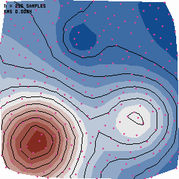 |  |
| `compose`: el campo de la placa, sus curvas de nivel y una capa de anotaciones (texto, flecha, marco) | `compose`: fondo de papel, la reconstrucción en una rampa divergente con las muestras marcadas, y etiquetas | `anim.frames`: los 33 fotogramas que imprimió un programa Lean después de que su núcleo comprobara que el planeador vuelve en 32 generaciones |

### Matemática clásica

| | | |
|---|---|---|
|  | 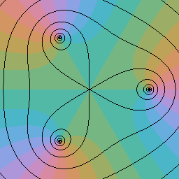 | 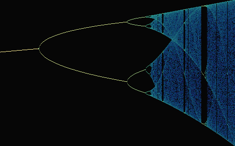 |
| Retrato de fase mejorado de (z²−1)(z−2−i)²/(z²+2+2i): ceros y polos están donde se juntan todos los colores | z³ − 1: las tres raíces cúbicas de la unidad | Diagrama de bifurcación de la aplicación logística, r de 2,8 a 4 |
| 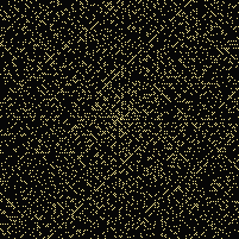 | 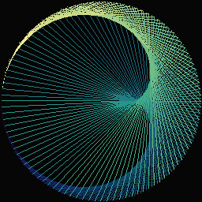 | 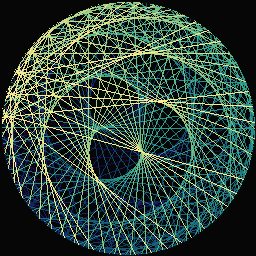 |
| La espiral de Ulam de los primos hasta 40 401 | Cuerdas j → 2j mod 200: la cardioide | Cuerdas j → 34j mod 300 |
| 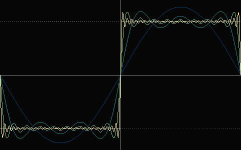 | 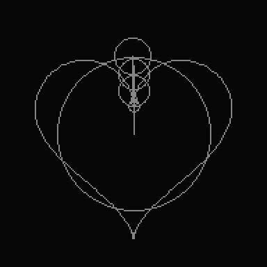 | 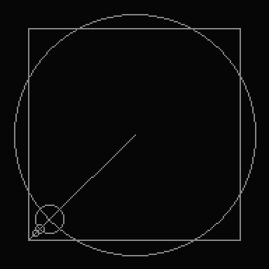 |
| Sumas parciales de Fourier de la onda cuadrada con 1, 3, 9 y 27 términos: el sobrepico junto al salto se queda cerca del 9 % (Gibbs) | Una curva cerrada dibujada por sus 24 mayores coeficientes de Fourier discretos, como círculos que giran | Un cuadrado necesita más círculos (aquí 40): en las esquinas la serie converge despacio |

### Estructuras matemáticas

| | | |
|---|---|---|
| 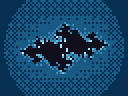 | 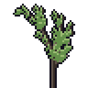 | 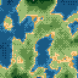 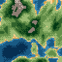 |
| Un conjunto de Julia por tiempo de escape, tramado ordenado entre tonos | Un sistema L estocástico (Lindenmayer) con racimos de hojas en espiral de Vogel | fBm con deformación de dominio en coordenadas de mundo: dos teselas vecinas encajan sin costura |
| 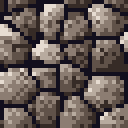 | 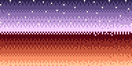 | 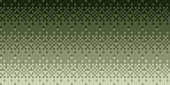 |
| Celdas de Voronoi (distancia F2 − F1), periódicas | Difusión de error de Floyd–Steinberg a una paleta fija, muestreo de disco de Poisson | El mismo degradado con 4 colores y Bayer 8×8 |

**Sonificación.** `music.piece` lee una sucesión matemática (57 fuentes: periodos de Pisano, el ángulo áureo, Thue–Morse, la
ecuación de Kepler, ceros de la función zeta de Riemann, pilas de arena, la órbita en ocho de tres cuerpos…) como melodía, la
armoniza por programación dinámica (Viterbi) y la reparte entre voces con el mínimo movimiento. Ejemplos:
[periodo de Pisano de 7](gallery/music-pisano.mid), [copo de Packard](gallery/music-packard.mid),
[un sistema L](gallery/music-lsystem.mid), [un planeador de Vida](gallery/music-life-night.mid).

## Usarlo para investigar

Cada ejemplo se reproduce con este repositorio; las cifras citadas se midieron con las órdenes que se muestran.

**1. Comparar dos reglas desde la misma condición inicial.** La semilla fija la sopa aleatoria, así que cambiar solo `rule`
es un experimento controlado ([Conway](examples/recipes/life-conway.json) y [B37/S2378](examples/recipes/life-b37s2378.json)
en la galería solo difieren en ese campo):

```sh
python -m exactfig render examples/recipes/life-b37s2378.json --out-dir out
```

Para barrer reglas o densidades, escribe una receta por valor y apúntalas todas; el manifiesto documenta el barrido entero:

```python
import json
for b in ("3", "36", "37", "38"):
    r = {"generator": "anim.life", "seed": "soup-1", "palette": "sci", "size": [96, 64], "scale": 3,
         "params": {"rule": f"B{b}/S23", "frames": 150}, "output": f"sweep/B{b}.gif"}
    json.dump(r, open(f"sweep-B{b}.json", "w"))
# python -m exactfig record sweep-*.json --manifest study/manifest.json
```

**2. Medir la precisión de una reconstrucción.** La interpolación lineal a trozos tiene error O(h²), con h ~ n^(−1/2) para n
muestras bien repartidas. Con la función de Franke en los n primeros puntos de Halton, en 128 × 128 píxeles dentro del casco
convexo:

| muestras | error RMS | píxeles dentro del casco |
|--:|--:|--:|
| 64 | 0,0246 | 84,3 % |
| 128 | 0,0151 | 91,1 % |
| 256 | 0,0084 | 94,8 % |

```python
from exactfig.data import io, scatter
p = io.read_points_csv("gallery/data/franke-halton-256.csv")
z = scatter.linear(p.xs[:64], p.ys[:64], p.vs[:64], 128, 128, (0.0, 1.0, 0.0, 1.0))   # NaN fuera del casco
```

**3. Sensibilidad a las condiciones iniciales.** Dos órbitas de Lorenz que empiezan a 10⁻⁹ de distancia (RK4, dt = 0,005) se
separan exponencialmente: ajustar el logaritmo de la distancia frente al tiempo (para t > 14, mientras la distancia está entre
10⁻⁸ y 10⁻²) da una pendiente de 0,88, cerca del mayor exponente de Lyapunov del sistema (unos 0,906); la distancia llega a 1
en t ≈ 32,6. Como la aritmética es reproducible al bit, esta divergencia es la misma en cualquier máquina:

```python
from exactfig.forge.motion import lorenz_path
a = lorenz_path(8000, 0.005, 10.0, 28.0, 8 / 3, (1.0, 1.0, 1.0))
b = lorenz_path(8000, 0.005, 10.0, 28.0, 8 / 3, (1.0 + 1e-9, 1.0, 1.0))
```

**4. Óptica de ondas.** `anim.wave` resuelve u_tt = c²∇²u; cambia `separation` (separación de las rendijas, d) o `period`
(longitud de onda λ = speed × period celdas) y las franjas se mueven según sen θ = mλ/d. El campo de la doble rendija es
exactamente simétrico, bit a bit (una prueba lo comprueba), así que cualquier asimetría que veas en una variante sale de tu
geometría, no del redondeo.

**5. Publicar una figura con sus datos.** Pon los datos junto al manifiesto, escribe una receta que los nombre, `record`, y
publica la figura, los datos, el manifiesto y su `manifest_sha256`. Quien lo lea ejecuta `verify`: vuelve a leer tus datos,
comprueba su hash y recalcula la figura.

## Recetas: semillas, paletas, parámetros, edición

```json
{"generator": "data.scatter", "seed": "franke", "palette": "sci", "size": [256, 256], "scale": 1,
 "input": {"path": "data/franke-halton-256.csv"},
 "params": {"method": "linear", "contours": 9, "points": "dot"}, "output": "franke-linear.png"}
```

| Clave | Significado |
|---|---|
| `generator` | un generador registrado (`exactfig list`) |
| `seed` | texto o entero (≤ 64 caracteres). Se convierte por SHA-256 en los flujos aleatorios del generador: la misma semilla da el mismo resultado en cualquier máquina y en cualquier proceso, y otra semilla da una tirada independiente. Los generadores sin azar (datos, ondas, Lorenz, Julia, gema) la ignoran |
| `palette` | un nombre incluido (`mf32`, `mono4`, `sci`; `exactfig palettes` lista sus rampas) o la tuya: `{"name": "mia", "colors": ["#rrggbb", …], "ramps": {"seq": [0, 1, 2], …}}` (1–256 colores) |
| `size`, `scale` | tamaño nativo en píxeles y ampliación entera por vecino más cercano (1–16) |
| `params` | se comprueban contra el esquema cerrado del generador: claves desconocidas y valores fuera de rango son errores |
| `input` | solo generadores de datos: `{"path", "format", "sha256"}`; ver [Tus propios datos](#tus-propios-datos) |
| `output` | nombre del fichero, relativo a la carpeta del manifiesto; no forma parte de la identidad de la receta |

**Forma normal.** Al apuntar una receta se escribe cada parámetro con su valor (los de por defecto incluidos) y se añade el
hash de la entrada. Así, un cambio posterior de un valor por defecto nunca puede cambiar lo que significa un manifiesto antiguo.

**Edición.** Cambia la receta y vuelve a apuntarla: la entrada del manifiesto se sustituye y `verify` comprueba la nueva. Un
generador cuyo cambio de código mueve algún píxel de salida recibe una `version` nueva; un asset apuntado con la anterior
falla entonces en `verify` hasta que se vuelve a apuntar, así que un cambio silencioso es imposible. La paleta `sci` tiene una
rampa secuencial de luminosidad OKLab estrictamente creciente (12 pasos), una divergente simétrica en luz alrededor de un gris
neutro (11), grises, tinta, papel y un color de marca.

## Tus propios datos

| Formato | Rejilla (`data.field`, `anim.diffuse`) | Puntos (`data.scatter`) |
|---|---|---|
| CSV, TSV, TXT | una fila por línea, la de arriba primero; `,` `;` tabulador o espacios; comentarios con `#`; vacío, `nan`, `NA` = sin dato | tres columnas x, y, valor; cabecera opcional |
| PGM de Netpbm | P2 o P5, 8 o 16 bits | — |
| `.npy` de NumPy | formato 1.0–3.0, 2-D, orden C o Fortran; float16/32/64, enteros, bool; cualquier orden de bytes | — |
| JSON | `{"values": [[…], …]}` o una lista de filas; `null` = sin dato | `{"points": [[x, y, v], …]}` o `{"x": […], "y": […], "value": […]}` |

La ruta de entrada es relativa a la carpeta del manifiesto y no puede salir de ella; `record` rellena su SHA-256. Los ficheros
son solo datos: no se evalúa nada, se rechazan las matrices de objetos, los tamaños tienen límite (64 MiB, 4096 × 4096
celdas, 200 000 puntos) y cada rechazo dice el motivo. Los lectores coinciden con NumPy y Pillow en los mismos ficheros (se
prueba cuando están instalados).

`data.field` dibuja una rejilla por valor, por sombreado o por ambos (`mode`), con curvas de nivel (`contours` o `interval`), el
rango de color de los datos o de `range`, y tramado opcional entre tonos de la paleta. `data.scatter` reconstruye muestras
dispersas por interpolación lineal sobre Delaunay (`linear`) o por la muestra más cercana (`nearest`); los píxeles fuera del
casco convexo no tienen valor y quedan transparentes salvo que se dé `nodata_ramp`. Listas completas de parámetros:
`python -m exactfig list`.

## Animaciones y vídeo

| Generador | Qué calcula |
|---|---|
| `anim.life` | autómatas celulares tipo Vida con cualquier regla `B…/S…`, en toro o tablero acotado, desde una sopa aleatoria o un patrón clásico (planeador, R-pentominó, bellota, diehard, parpadeador); células vivas coloreadas por edad |
| `anim.wave` | la ecuación de ondas 2-D por leapfrog: doble rendija, una rendija, una fuente puntual, dos fuentes; paredes reflectantes, borde absorbente; estable para número de Courant ≤ 1/√2 (se impone) |
| `anim.lorenz` | el sistema de Lorenz por RK4, con un calentamiento que pasa el transitorio inicial, dibujado como una estela que se apaga |
| `anim.diffuse` | la ecuación del calor sobre una rejilla de datos (FTCS, bordes reflectantes: el total se conserva), estable para α ≤ 1/4 (se impone) |

El nombre de salida elige el contenedor: `.gif` (GIF89a) o `.png` (APNG). Los dos los escribe y los lee el propio exactfig,
mantienen el bloqueo de paleta y se repiten en bucle. El hash de contenido apuntado cubre el tamaño, el número de fotogramas y
el retardo y los píxeles de cada uno, y no depende del contenedor. GIF guarda los retardos en centésimas de segundo, así que
`delay` es múltiplo de 10 ms.

Para compartir, `python -m exactfig video RECETA.json --out clip.mp4 --scale 4` codifica los fotogramas en H.264 con
[FFmpeg](https://ffmpeg.org/) si está instalado. Un MP4 tiene pérdida y **no es verificable**: verifica el GIF/APNG del que sale
(la orden imprime el hash de sus fotogramas).

## Capas y edición

Una receta `compose` apila capas sobre un mismo lienzo. Cada capa es una receta de cualquier generador de imagen, también los
de datos, sin paleta, tamaño ni escala (los hereda), y con un `blend`: `over` (sus píxeles opacos tapan lo de abajo), `under`
(solo rellena lo que sigue transparente) o `mask` (lo de abajo sobrevive solo donde la capa es opaca):

```json
{"generator": "compose", "seed": "fig-plate", "palette": "sci", "size": [256, 256], "layers": [
  {"generator": "data.field", "input": {"path": "data/plate-129.npy"}, "params": {"interval": 0.1}},
  {"generator": "draw.annotate", "params": {"shapes": [
    {"type": "text", "points": [[6, 6]], "text": "U = 1 ON TOP", "r": 2},
    {"type": "arrow", "points": [[128, 200], [128, 120]], "r": 6, "ramp": "paper"}]}}],
 "output": "figure-plate.png"}
```

`draw.annotate` dibuja líneas, polilíneas, polígonos, rectángulos, círculos, marcas, flechas, barras de escala y texto (una
fuente de mapa de bits de 3 × 5 definida en el código), en píxeles o en coordenadas unitarias del lienzo. Como mucho 64 formas
de como mucho 64 puntos, así que una anotación no puede llevar una imagen. La versión y el hash de código de una composición
cubren el generador de cada capa.

Para editar, cambia la receta a mano o con `exactfig edit`, que comprueba el resultado contra el esquema antes de escribirlo:

```sh
python -m exactfig edit examples/recipes/figure-plate.json --set layers.0.params.interval=0.05 --set seed=v2
python -m exactfig record examples/recipes/figure-plate.json --manifest gallery/manifest.json
```

Al volver a apuntar un asset cuya receta o contenido cambió, su entrada guarda lo que era en `history` (hashes de receta y
de contenido, versión del generador, el más reciente primero): el manifiesto documenta sus propias ediciones, y `verify`
comprueba la entrada actual.

## Lean

[`lean/`](lean) contiene Lean 4 puro (solo el núcleo, sin Mathlib), usado de dos formas:

- **Demostrar propiedades de los algoritmos que usa exactfig.** `Line.lean` reescribe la recta de Bresenham de
  `pxmath.line` y demuestra, para todo par de extremos en 0..4, que la recta empieza y acaba en sus extremos, es
  8-conexa y tiene max(|Δx|, |Δy|) + 1 puntos. Su salida para las 2401 rectas con extremos en −3..3 se compara, punto a
  punto, con lo que dibuja exactfig.
- **Calcular datos cuyas propiedades están demostradas, y dibujarlos.** `Life.lean` demuestra que un planeador avanza una
  casilla en diagonal en cuatro generaciones y vuelve tras 32 en un toro de 8 × 8, y que el parpadeador tiene periodo
  exactamente 2; `anim.frames` anima los fotogramas que imprime, fijados por SHA-256. La Vida de exactfig los reproduce
  fotograma a fotograma.

Los teoremas los comprueba el núcleo de Lean (`decide +kernel`), de forma exhaustiva sobre los casos enunciados.
`tests/test_lean.py` no necesita Lean: compara las salidas guardadas con el código de exactfig y rechaza `sorry`, `axiom` o
`native_decide`. Detalle: [lean/README.md](lean/README.md).

El mismo patrón sirve para cualquier cálculo en el que confíes más en Lean que en Python: escríbelo en Lean, demuestra lo que
importe, imprime JSON y dibújalo con `anim.frames` (una sucesión de rejillas) o `data.field` (una rejilla).

## Matemáticas por área

Las áreas de [awesome-math](https://github.com/rossant/awesome-math) y lo que este repositorio ya calcula y dibuja en cada
una. Cada entrada es un generador o una receta de la galería.

| Área | En exactfig | Galería |
|---|---|---|
| Análisis complejo | retratos de fase mejorados (Wegert): ceros, polos y su orden, singularidades esenciales (`math.domain`) | [Wegert](gallery/domain-wegert.png), [z³ − 1](gallery/domain-roots.png) |
| Sistemas dinámicos y caos | bifurcaciones de la aplicación logística (`math.logistic`); atractor de Lorenz por RK4 (`anim.lorenz`); sensibilidad a las condiciones iniciales | [logística](gallery/logistic.png), [Lorenz](gallery/lorenz.gif) |
| Teoría de números | espiral de Ulam de primos o restos (`math.ulam`); círculos de multiplicación modular (`math.modmult`); periodos de Pisano, Thue–Morse, ceros de zeta como sonido (`music.piece`) | [Ulam](gallery/ulam-primes.png), [cardioide](gallery/modmult-cardioid.png) |
| Ecuaciones en derivadas parciales | Laplace (solución exacta de la placa), ecuación de ondas por leapfrog (`anim.wave`), ecuación del calor sobre datos (`anim.diffuse`) | [placa](gallery/plate-temperature.png), [doble rendija](gallery/wave-double-slit.gif), [difusión](gallery/dem-diffusion.gif) |
| Análisis numérico | libm portable (`fmath`, ≤ 1 ulp), predicados de Delaunay exactos, interpolación O(h²), RK4 de orden 4, estabilidad CFL impuesta | [Franke](gallery/franke-linear.png) |
| Geometría computacional | triangulación de Delaunay (giros de Lawson), celdas de Voronoi, campos de distancia con signo, curvas de Bézier, Bresenham | [Voronoi](gallery/stone-slabs.png), [vecino](gallery/franke-nearest.png) |
| Combinatoria y matemática discreta | autómatas celulares tipo Vida con cualquier regla B/S (`anim.life`), sistemas L; pilas de arena como sonido | [Vida](gallery/life-conway.gif), [B37/S2378](gallery/life-b37s2378.gif), [helecho](gallery/tree-fern.png) |
| Probabilidad y procesos estocásticos | muestras cuasialeatorias de Halton, muestreo de disco de Poisson, sopas aleatorias con semilla, superficies brownianas fraccionarias (fBm) | [terreno](gallery/terrain-0-0.png) |
| Análisis de Fourier | sumas parciales y fenómeno de Gibbs (`math.fourier`); la transformada discreta de una curva cerrada dibujada como epiciclos (`anim.epicycles`) | [Gibbs](gallery/fourier-square.png), [epiciclos](gallery/epicycles-heart.gif) |
| Señales e información | tramado ordenado (Bayer) y por difusión de error, cuantización a paleta, LZW (GIF), sonificación | [cielo](gallery/sky-dusk.png), [mono](gallery/sky-mono.png) |
| Procesamiento de imagen | remuestreo por área en luz lineal, paletas por median cut y k-medias, bordes de Sobel (`data.image`) | [conversión](gallery/convert-kmeans16-edges.png) |
| Fractales | conjuntos de Julia por tiempo de escape | [Julia](gallery/julia.png) |
| Geografía y superficies | sombreado de relieve (Horn), tinte hipsométrico, curvas de nivel (marching squares) | [relieve](gallery/dem-relief.png), [sombreado](gallery/dem-hillshade.png) |
| Ciencia del color | paletas OKLab: secuencial de luz creciente, divergente simétrica en luz, cíclica a igual luz | todas las figuras |
| Matemática formal | demostraciones en Lean 4 del algoritmo de la recta y de hechos de autómatas, con sus salidas dibujadas y contrastadas | [planeador Lean](gallery/lean-glider.gif) |

**Siguientes pasos evidentes, aún sin hacer.** Cada uno sería un generador puro con una prueba contra un hecho conocido:
el conjunto de Mandelbrot y animaciones de zoom (fractales); agregados de
percolación y su umbral (probabilidad); un tablero de Galton que converge a la binomial (estadística); figuras de Chladni y
modos propios de una membrana (EDP, álgebra lineal); grafos de Cayley de grupos pequeños (teoría de grupos); árboles de
expansión mínima y caminos más cortos (grafos); geodésicas en una esfera o un toro (geometría diferencial).

## Conversión de imágenes

`data.image` convierte una imagen en color real (PNG de cualquier tipo de color de 8 bits, o PPM de Netpbm) en píxeles de
paleta. La imagen es una entrada como cualquier fichero de datos: se nombra en la receta, se fija por SHA-256 y `verify` la
vuelve a leer.

1. **Remuestreo** al tamaño de salida: `area` toma la media exacta, ponderada por área, de los píxeles de origen que cubre
   cada píxel de destino, **en luz lineal** (promediar valores sRGB oscurece todos los bordes entre dos colores: mitad negro
   y mitad blanco tiene que dar sRGB 188, no 128); `nearest` toma el píxel de origen bajo el centro de cada píxel de destino.
2. **Cuantización** a la paleta, color más cercano en OKLab: directamente, tras un desplazamiento de Bayer 8 × 8 (`spread`) o
   con difusión de error de Floyd–Steinberg. `ramp` limita los colores que puede tomar un píxel.
3. **Contorno opcional**: el gradiente de Sobel de la luminosidad OKLab por encima de `edge_threshold`, dibujado en
   `edge_ramp`.

Se puede sacar una paleta de la propia imagen, por median cut (Heckbert) o k-medias en OKLab arrancando de median cut
(determinista: la misma imagen da siempre la misma paleta):

```sh
python -m exactfig palette gallery/data/testcard-480x320.png --k 16 --method kmeans --out testcard-k16.json
```

La salida es un objeto de paleta (colores de oscuro a claro, rampas `all`, `ink`, `paper`) para pegar en el `palette` de una
receta. La imagen de origen de la galería también sale de código (`examples/data/make_data.py`): una rueda de color OKLCh,
cuatro degradados y dos figuras con bordes suavizados.

| | | | |
|---|---|---|---|
| 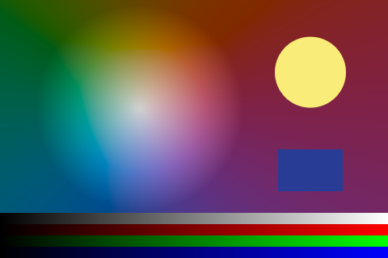 | 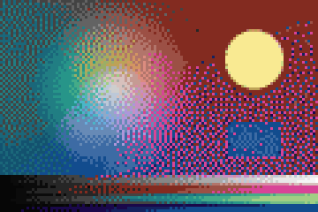 | 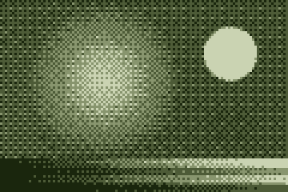 | 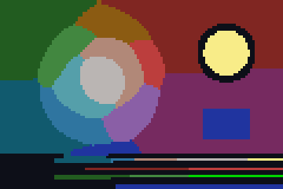 |
| El origen, 480 × 320 en color real | 120 × 80, paleta `sci`, Floyd–Steinberg | 120 × 80, 4 colores (`mono4`), Bayer 8 × 8 | 120 × 80, 16 colores por k-medias, contorno de Sobel |

## Verificación

```sh
python -m exactfig verify --manifest gallery/manifest.json            # avisos si cambió el código o se recomprimió un fichero
python -m exactfig verify --manifest gallery/manifest.json --strict   # …que entonces son fallos
python -m exactfig verify --json                                       # un informe para máquinas
```

Para cada entrada, en orden: el hash y la forma normal de la receta, el generador y su versión, el hash del código, el hash de
cada fichero de entrada, el hash de contenido de la nueva ejecución, el fichero en disco (píxeles decodificados en PNG, cada
fotograma en GIF/APNG, bytes en MIDI), el bloqueo de paleta, los bytes del fichero (informativos salvo con `--strict`) y, al
final, `manifest_sha256`. Un fallo dice qué difiere: cuántos píxeles y el primero, el primer fotograma distinto, el primer byte
distinto o qué entrada cambió. Código de salida 0 si todo pasa. Especificación: [docs/MANIFEST.md](docs/MANIFEST.md); esquema
JSON: [exactfig/provenance/manifest.schema.json](exactfig/provenance/manifest.schema.json).

## API de Python

```python
from exactfig.render import render                      # receta → Rendered (bytes, hash de contenido, tamaño, fotogramas)
from exactfig.data import io, field, scatter              # lectores, muestreo, sombreado, curvas de nivel, Delaunay
from exactfig import fmath                                # sin, cos, atan2, exp, log, pow, cbrt, hypot portables
from exactfig.forge.motion import lorenz_path, life_step  # las simulaciones de las animaciones

out = render({"generator": "anim.life", "seed": 7, "palette": "sci", "size": [64, 48],
              "params": {"rule": "B36/S23", "frames": 60}, "output": "highlife.gif"})
open("highlife.gif", "wb").write(out.data)
tris = scatter.delaunay([0.0, 1.0, 0.0, 1.0], [0.0, 0.0, 1.0, 1.0])     # tríos de índices en sentido antihorario
```

## Reproducibilidad numérica

`sin`, `pow` y compañía de la biblioteca del sistema pueden diferir en el último bit entre bibliotecas de C, y código C como
`math.hypot` puede compilarse con multiplicación y suma fusionadas (FMA); cualquiera de las dos cosas puede mover un píxel que
esté en un umbral. Por eso los generadores usan `exactfig.fmath`, que construye `sin`, `cos`, `atan`, `atan2`, `exp`, `log`,
`log2`, `pow`, `cbrt`, `hypot` y las distancias solo con `+ − × ÷` y `sqrt` (todas con redondeo correcto en IEEE 754), según
fdlibm. Precisión frente a la biblioteca del sistema: 1 ulp como mucho en sin, cos, atan, atan2, exp, log y log2; 2 ulp en cbrt;
error relativo de pow menor que 2·10⁻¹⁴. Los argumentos fuera de la reducción exacta se rechazan, nunca dan un resultado
erróneo en silencio. Las pruebas fijan resultados de fmath como patrones de bits y fallan si el código del paquete llama a las
funciones trascendentes del sistema o a `**` con decimales. Los predicados de Delaunay son exactos (aritmética entera) y los
números de los ficheros de entrada los lee el `float` de Python, con redondeo correcto. La galería se reproduce exacta en
x86-64 y ARM64, en dos sistemas operativos.

## Límites

- **Velocidad.** Python puro: un campo de 256 × 256 tarda de uno a dos segundos; las animaciones de la galería, de segundos a un
  minuto. Los tamaños tienen límite (2048 px por lado en figuras de datos; 1000 fotogramas y 64 millones de píxeles por
  animación).
- **La compresión PNG y GIF** puede cambiar entre implementaciones; `verify` compara píxeles decodificados y los bytes del
  fichero son informativos salvo con `--strict`.
- **El MP4** es solo para compartir (tiene pérdida).
- **Elegir se permite.** Quedarse con la semilla más bonita es curaduría, y la semilla está en la receta.

## Arquitectura

```
exactfig/
  fmath.py       funciones trascendentes portables (algoritmos de fdlibm, solo operaciones básicas IEEE 754)
  data/          io (lectores CSV, PGM, NPY, JSON), field (muestreo, sombreado, marching squares), scatter (Delaunay exacto)
  pixel/         pxmath (tramado, ruido, Worley, autómatas, fractales, Bézier, Bresenham, SDF, disco de Poisson), paletas
                 (OKLab), cuantización con paleta bloqueada, lienzo de índices, escritores y lectores PNG y GIF/APNG
  forge/         generadores: datavis (data.*), motion (anim.*), mathviz (math.*), annotate (draw.annotate), tiles, flora,
                 skies, icons, sprites
  music/         sucesiones, armonía (Viterbi), conducción de voces, compositor, escritor de MIDI estándar
  provenance/    record, verify, esquema JSON del manifiesto
  registry.py    los generadores, sus versiones y sus esquemas cerrados de parámetros
  render.py      receta → forma normal → salida
lean/            demostraciones y programas Lean 4 cuyas salidas exactfig dibuja y contrasta
examples/        recetas y el código que hace los conjuntos de datos de ejemplo
gallery/         las salidas apuntadas, sus datos y manifest.json
```

El núcleo (todo lo que calcula una figura) es puro y la capa exterior (ficheros, línea de órdenes, manifiesto) es fina; una
prueba lo impone. Ver [docs/ARCHITECTURE.md](docs/ARCHITECTURE.md): capas, invariantes y cómo añadir un generador.

## Referencias

La lista completa, con autores y años, está en la versión en inglés: [README.md#references](README.md#references).

## Citar

[CITATION.cff](CITATION.cff) da la cita; GitHub la muestra como «Cite this repository». Si una publicación usa una figura de
exactfig, publica con ella su manifiesto (o su `manifest_sha256`): es lo que permite a quien la lea comprobarla. Cambios por
versión: [CHANGELOG.md](CHANGELOG.md).

## Contribuir, seguridad, licencia

Ver [CONTRIBUTING.md](CONTRIBUTING.md) y [SECURITY.md](SECURITY.md). Licencia: la decide el dueño antes de publicar.
