# exactfig

**Scientific figures that check their data before they draw it, and that anyone can re-run bit for bit.**

[](https://github.com/joelcanary/exactfig/actions/workflows/tests.yml)
[](https://github.com/joelcanary/exactfig/releases)
[](#quickstart)
[](#architecture)
[](LICENSE)

[Leer en español](README.es.md)

A figure in a paper makes a claim. exactfig makes the figure **prove the part of the claim that can be checked**, and
**refuses to draw** when the data does not support it:

- a catalogue of still lifes is drawn only if every pattern is still under its rule, strict, of the stated size, and
  there are exactly as many as the sequence term says;
- a SAT solver's colouring is drawn only if no colour holds a forbidden progression or sum, and the figure records the
  hash of the proof of the other half of the theorem;
- an instance segmentation is drawn only if no mask is empty, no two instances overlap, the matching is one to one, and
  the stated PQ, TP, FP and FN equal the exact values; its caption must agree with the data's metadata.

Every figure comes from a small JSON *recipe* (a generator, its parameters, a seed and, for data, a pinned input file) and
is recorded in a *manifest*. `exactfig verify` runs every recipe again and compares the result with the file on disk,
**pixel for pixel, frame by frame, byte for byte**, on any machine; publishing one value (`manifest_sha256`) pins the
figure, its data and the code that drew it. Pure Python, no dependencies, Linux, macOS and Windows.

<table>
<tr><td width="33%" align="center" valign="top">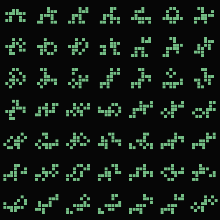<br><sub>The 49 strict still lifes of 14 cells under B368/S245, the term A175001(14) = 49 of the OEIS, each simulated before it is drawn</sub></td><td width="33%" align="center" valign="top">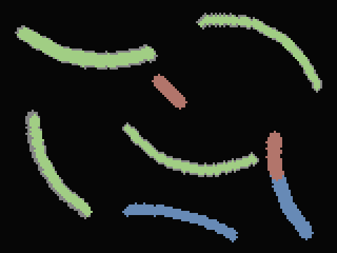<br><sub>Ground truth against prediction, matched one to one and scored exactly: PQ = 21153891139/45297262530 ≈ 0.4670, as the recipe states</sub></td><td width="33%" align="center" valign="top">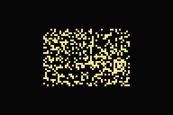<br><sub>Conway's Life from a seeded soup, cells coloured by age</sub></td></tr>
<tr><td width="33%" align="center" valign="top">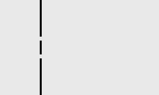<br><sub>The wave equation through a double slit (leapfrog, absorbing border)</sub></td><td width="33%" align="center" valign="top">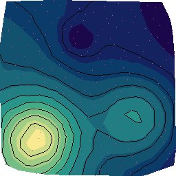<br><sub>Franke's function from 256 scattered samples (exact Delaunay)</sub></td><td width="33%" align="center" valign="top">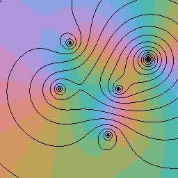<br><sub>Phase portrait of a complex function with modulus lines</sub></td></tr>
</table>

<p align="center"></p>

A SAT solver's colouring of 1..39 with no forbidden progression, so w(4; 2,3,3,3) > 39; the recipe names the DRAT proof,
checked by drat-trim and cake_lpr, that 1..40 has none: w(4; 2,3,3,3) = 40.

## Contents

- [What is guaranteed](#what-is-guaranteed)
- [Quickstart](#quickstart)
- [Gallery](#gallery)
- [Using it for research](#using-it-for-research)
- [Recipes: seeds, palettes, parameters, editing](#recipes-seeds-palettes-parameters-editing)
- [Your own data](#your-own-data)
- [Catalogues of patterns](#catalogues-of-patterns)
- [Colourings and SAT witnesses](#colourings-and-sat-witnesses)
- [Instance masks and segmentation](#instance-masks-and-segmentation)
- [Sequences, congruent numbers and sandpiles](#sequences-congruent-numbers-and-sandpiles)
- [Animations and video](#animations-and-video)
- [Layers and editing](#layers-and-editing)
- [Lean](#lean)
- [Image conversion](#image-conversion)
- [Mathematics by area](#mathematics-by-area)
- [Verification](#verification)
- [When something goes wrong](#when-something-goes-wrong)
- [Python API](#python-api)
- [Numerical reproducibility](#numerical-reproducibility)
- [Limits](#limits)
- [Architecture](#architecture)
- [References](#references)

## What is guaranteed

| Claim | How it is checked |
|---|---|
| The file is exactly what the recipe computes | `verify` re-runs the recipe and compares decoded pixels (every frame of an animation) or MIDI bytes |
| The input data is the data that was recorded | the recipe pins each input file by SHA-256; one changed byte fails `verify`, naming the file |
| The code is the code that was recorded | each entry stores a hash of the generator's source; a change is a warning, a failure with `--strict` |
| The colours are a declared palette | generators draw palette *indices*; `verify` checks every opaque pixel against the recorded palette |
| The same bits on every platform | transcendental functions come from `exactfig.fmath` (basic IEEE 754 arithmetic only); checked on x86-64 and ARM64 |
| The whole set is pinned | `manifest_sha256` covers every entry; sign or publish that one value |
| Recipes cannot smuggle a picture | closed parameter schemas: typed, ranged values, no pixel arrays; data enters only as a named, hashed file |
| The figure shows only what the data proves | `data.catalog`, `data.coloring`, `data.refutation`, `data.instances`, `data.sequence`, `data.bits`, `data.triangle`, `data.pratt`, `data.circuit`, `data.circuit_refutation`, `data.bounds`, `data.enclosures` and `math.sandpile` check the data against what the recipe states (rule, size, sequence term, progressions, sums, overlaps, exact scores, captions, primality, the cells of a table of bounds, that a certified ball excludes 0) and refuse to draw otherwise |
| The description says what was checked | every recorded file carries an alternative text written after its data passed their checks, from the checked numbers themselves (counts, sizes, the function a circuit computes, the exact panoptic quality); `verify` notices a text that no longer matches |
| Mistakes end in a clear message | one line saying what and why, never a traceback; more than 110 real mistakes are tested, one process each |

What it does not prove: who wrote the code or chose the recipe (sign the manifest digest for that), or that a model or a
dataset is right. It proves that *this output is what this code computes from these inputs*.

## Quickstart

Requires Python 3.10 or newer. Nothing to install.

```sh
python -m exactfig selftest                                # does this machine reproduce exactfig bit for bit? (seconds)
python -m exactfig list                                    # generators and their parameter schemas
python -m exactfig verify --manifest gallery/manifest.json --strict
python -m exactfig render examples/recipes/franke-linear.json --data-dir gallery --out-dir out
python -m unittest discover tests
```

`pip install -e .` also provides an `exactfig` command.

## Gallery

Every file below comes from a recipe in [`examples/recipes`](examples/recipes) and is recorded in
[`gallery/manifest.json`](gallery/manifest.json). The test suite verifies all of them.

### Data

| | | |
|---|---|---|
| 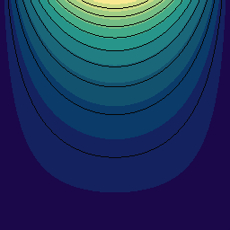 |  | 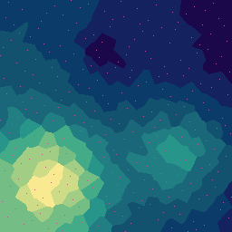 |
| Steady temperature of a plate, the exact solution of Laplace's equation (`.npy`), iso-lines every 0.1 | Franke's function from 256 Halton samples (CSV), Delaunay piecewise-linear interpolation, samples marked | The same samples, nearest-sample reconstruction (Voronoi cells) |
| 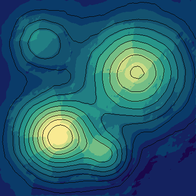 | 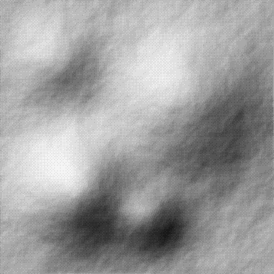 | 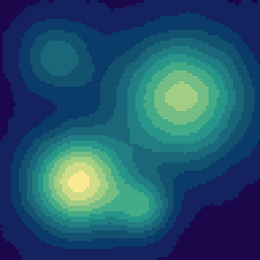 |
| Elevation model (16-bit PGM, 60 m cells): hypsometric tint with hill-shading and 200 m iso-lines | Hill-shading only (Horn's gradient, light from the north-west at 45°), Bayer dithering | The heat equation run on the same grid: its own diffusion, frame by frame |

### Dynamics

| | | |
|---|---|---|
|  |  |  |
| Conway's Life (B3/S23) from a seeded random soup, cells coloured by age | The rule B37/S2378 from the **same** soup (same seed): a controlled comparison of two rules | Two coherent point sources: interference and nodal lines |

### Checked before they are drawn

| | |
|---|---|
|  | `data.catalog`: the 49 strict still lifes of 14 cells under the Move rule B368/S245, the term A175001(14) = 49 of the OEIS. Before drawing, exactfig simulates every pattern and refuses the figure if one is not a still life, is a pseudo still life, does not have 14 cells, repeats another up to symmetry, or if there are not exactly 49. The picture cannot show more than the data proves. |
|  | `data.coloring`: a SAT solver's colouring of 1..39 with 4 colours, the first never used twice and the other three without a monochromatic 3-term arithmetic progression, so w(4; 2,3,3,3) > 39. exactfig checks it before drawing; the recipe also records the SHA-256 of the DRAT proof, checked by drat-trim and cake_lpr, that 1..40 has no such colouring: w(4; 2,3,3,3) = 40 (OEIS A217008). |
| 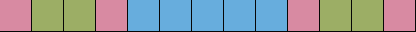 | `data.coloring` with `check: "schur"`: 1..13 split into three sum-free sets (no set holds x, y and x + y), so the Schur number S(3) is at least 13. |
| 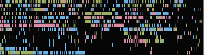 | `data.refutation`: the other half, a CaDiCaL proof (311 clauses, LRAT) that 1..14 cannot be split so, checked step by step against the formula exactfig writes from the claim. With the witness above, whose recipe names this proof by its SHA-256: S(3) = 13. |
| 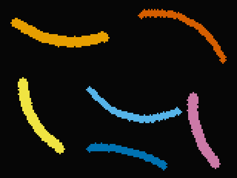 | `data.instances`, `mode: "instances"`: a synthetic segmentation scene, six filament-like instances in compressed COCO RLE, each in its own hue. Refused if a mask is empty or two instances share a pixel. |
|  | `data.catalog` with `check: "ship"`: Conway's light, middle and heavy spaceships, each checked to come back moved by (−2, 0) after exactly 4 generations, and to no translate of itself before. |
| 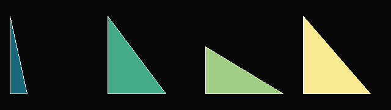 | `data.triangle`: right triangles with rational sides for the congruent numbers 5, 6, 7 and 157; the last one has sides with numerators of up to 48 digits. a² + b² = c² and a·b/2 = n are checked in exact fractions before drawing. |
| 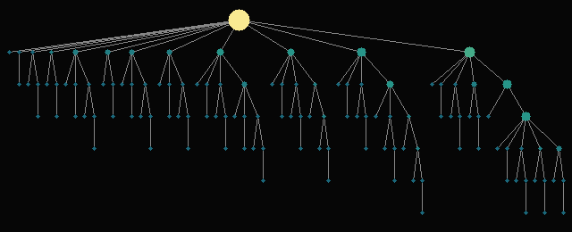 | `data.pratt`: the Pratt certificate that 2^127 − 1 is prime, as a tree: below each prime, the primes of p − 1, down to 2; the disc grows with the bits. Each of the 19 lines is checked before drawing (p − 1 factored, a witness of order p − 1). A composite number has no certificate, so no file can make this figure lie. |
| 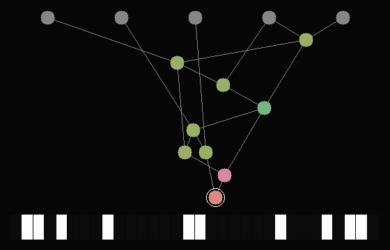 | `data.circuit`: a circuit of 9 two-input gates that outputs 1 exactly when x1 + … + x5 leaves remainder 1 on division by 3, the smallest size for this function (Knuth, TAOCP 7.1.2). Inputs on top, each gate on the row of its depth, coloured by its operation; along the bottom, the output on each of the 32 inputs. Before drawing, exactfig evaluates the circuit on all 32 and refuses it if one differs, if a gate is unused or if it does not have 9 gates. |
| 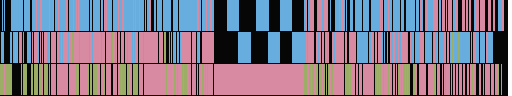 | `data.circuit_refutation`: the proof (CaDiCaL, LRAT, 677 clauses) that no circuit of 3 gates outputs 1 exactly when one of x1, x2, x3 is 1, checked against the formula exactfig writes from the claim; one row per gate, in proof order. With [the 4-gate circuit](gallery/mod3-n3-circuit.png), whose recipe names this proof by its SHA-256, the size is exactly 4. |
| 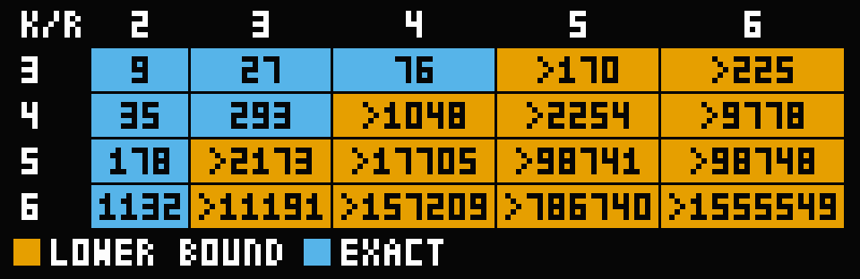 | `data.bounds`: what is known about the van der Waerden numbers W(r, k) (rows k = 3–6, columns r = 2–6 colours): 7 exact values and 13 lower bounds, as printed in the literature (sources in the data file's header). Before drawing, exactfig checks that the values never decrease along a row or down a column, that the table has 7 exact cells and 13 bounds, and that the seven exact values are the ones the recipe states; the test suite recomputes W(2, 3) = 9 by brute force. |
| 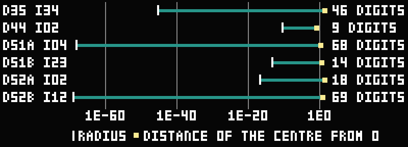 | `data.enclosures`: six certified enclosures from two unrefereed preprints on the Hodge conjecture for Fermat varieties (the residue functionals of Peterson's family in degree 35 and of Bhattacharjee's five families in degrees 44, 51 and 52), recomputed independently with interval arithmetic. Each bar runs, on a log10 axis, from the radius of the ball to the distance of its centre from 0; the number at the end is how many decimal digits the ball misses 0 by (9 to 69). Before drawing, exactfig checks exactly that every ball excludes 0, that the lower bounds the papers quote hold for every value in the ball, and that each ball lies within the papers' printed digits of their published values. |
| 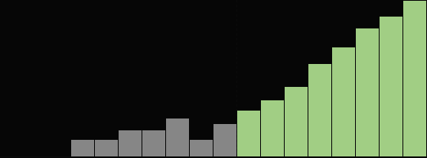 | `data.sequence`: the OEIS b-file of A175001 on a logarithmic scale, the terms from n = 11 on (6, 10, 18, 49, 103, 228, 376, 745) highlighted and checked against the file. |
| 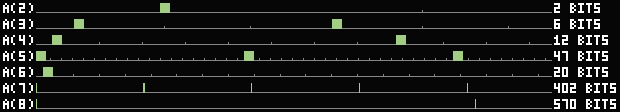 | `data.bits`: the partial quotients a(2) to a(8) of OEIS A402278 in binary, the units on the right. In decimal they look like noise (a(7) has 121 digits); in binary each is a comb, with its ones at equal steps, by a theorem of Adams and Davison (1977). The recipe states the start, the step and the number of ones of each, and exactfig checks every bit. |
| 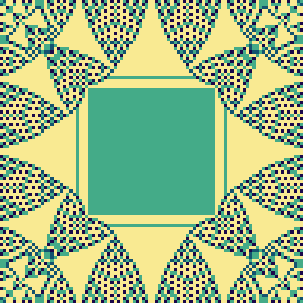 | `math.sandpile`: the identity of the sandpile group of a 96 × 96 grid, computed with Creutz's formula and checked: stable, and e ⊕ e = e. For n ≤ 14 a stated group order is checked against the number of spanning trees. |
|  | `mode: "compare"`: the same ground truth against six predictions, matched one to one by IoU > 1/2 and scored exactly: the agreed pixels, the pixels only one side has (grey), false positives (warm) and false negatives (cool). The recipe states TP 4, FP 2, FN 2 and PQ 0.4670; the exact PQ is 21153891139/45297262530, and a recipe that said anything else would not render. |

### Layers and Lean

| | | |
|---|---|---|
| 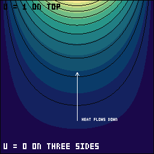 | 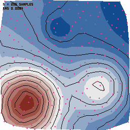 |  |
| `compose`: the plate's field, its iso-lines, and an annotation layer (text, arrow, frame) | `compose`: a paper background, the reconstruction on a diverging ramp with the samples crossed, and labels | `anim.frames`: the 33 frames a Lean program printed after its kernel checked that the glider returns in 32 generations |

### Classical mathematics

| | | |
|---|---|---|
|  | 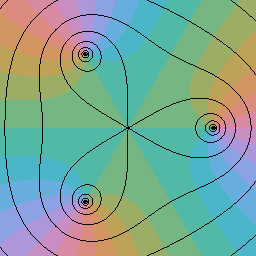 | 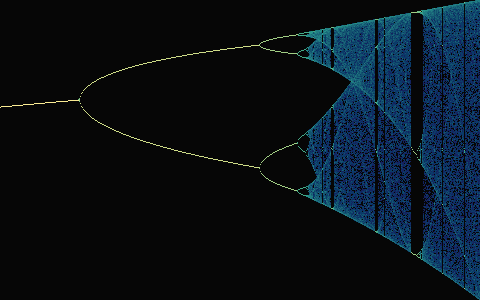 |
| Enhanced phase portrait of (z²−1)(z−2−i)²/(z²+2+2i): zeros and poles are where all colours meet | z³ − 1: the three cube roots of unity | Bifurcation diagram of the logistic map, r from 2.8 to 4 |
| 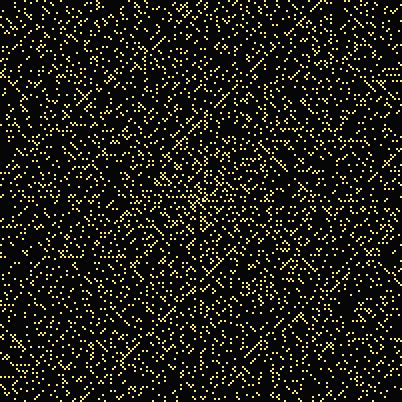 | 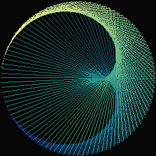 | 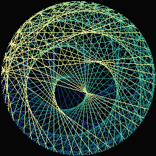 |
| The Ulam spiral of the primes up to 40 401 | Chords j → 2j mod 200: the cardioid | Chords j → 34j mod 300 |
| 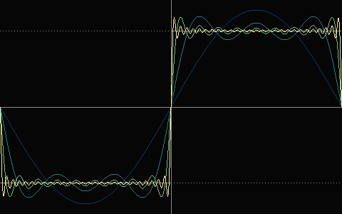 | 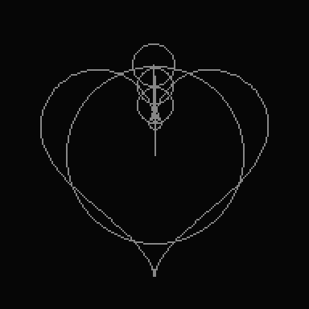 | 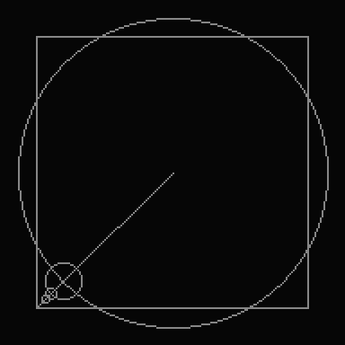 |
| Fourier partial sums of the square wave with 1, 3, 9 and 27 terms: the overshoot at the jump stays near 9 % (Gibbs) | A closed curve drawn by its 24 largest discrete Fourier coefficients, as rotating circles | A square needs more circles (40 here): its corners are where the series converges slowly |

### Mathematical structures

| | | |
|---|---|---|
| 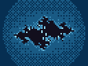 | 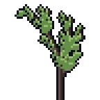 | 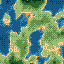 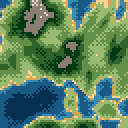 |
| A Julia set by escape time, ordered dithering between ramp steps | A stochastic L-system (Lindenmayer) with Vogel-spiral leaf clusters | Domain-warped fBm in world coordinates: two adjacent tiles join without a seam |
| 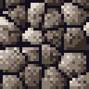 | 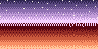 | 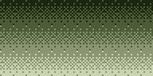 |
| Voronoi cells (F2 − F1 distance), periodic | Floyd–Steinberg error diffusion to a fixed palette, Poisson-disc sampling | The same gradient with 4 colours and Bayer 8×8 |

**Sonification.** `music.piece` reads a mathematical sequence (57 sources: Pisano periods, the golden angle, Thue–Morse,
Kepler's equation, zeros of the Riemann zeta function, sandpiles, the figure-eight three-body orbit…) as melody, harmonises it
by dynamic programming (Viterbi) and voices it with minimal voice leading. Examples:
[Pisano period of 7](gallery/music-pisano.mid), [Packard's snowflake](gallery/music-packard.mid),
[an L-system](gallery/music-lsystem.mid), [a Life glider](gallery/music-life-night.mid).

## Using it for research

Each example below is reproducible from this repository; the numbers quoted were measured with the commands shown.

**1. Compare two rules from the same initial condition.** A seed fixes the random soup, so changing only `rule` is a
controlled experiment ([Conway](examples/recipes/life-conway.json) and [B37/S2378](examples/recipes/life-b37s2378.json) in
the gallery differ in that one field):

```sh
python -m exactfig render examples/recipes/life-b37s2378.json --out-dir out
```

To sweep rules or densities, write one recipe per value and record them all; the manifest then documents the whole sweep:

```python
import json
for b in ("3", "36", "37", "38"):
    r = {"generator": "anim.life", "seed": "soup-1", "palette": "sci", "size": [96, 64], "scale": 3,
         "params": {"rule": f"B{b}/S23", "frames": 150}, "output": f"sweep/B{b}.gif"}
    json.dump(r, open(f"sweep-B{b}.json", "w"))
# python -m exactfig record sweep-*.json --manifest study/manifest.json
```

**2. Measure the accuracy of a reconstruction.** Piecewise-linear interpolation has error O(h²), with h ~ n^(−1/2) for n
well-spread samples. On Franke's function at the first n Halton points, rendered on 128 × 128 pixels inside the convex hull:

| samples | RMS error | pixels inside the hull |
|--:|--:|--:|
| 64 | 0.0246 | 84.3 % |
| 128 | 0.0151 | 91.1 % |
| 256 | 0.0084 | 94.8 % |

```python
from exactfig.data import io, scatter
p = io.read_points_csv("gallery/data/franke-halton-256.csv")
z = scatter.linear(p.xs[:64], p.ys[:64], p.vs[:64], 128, 128, (0.0, 1.0, 0.0, 1.0))   # NaN outside the hull
```

**3. Sensitivity to initial conditions.** Two Lorenz orbits started 10⁻⁹ apart (RK4, dt = 0.005) separate exponentially;
fitting log-distance against time (for t > 14, while the distance is between 10⁻⁸ and 10⁻²) gives a slope of 0.88, close to
the system's largest Lyapunov exponent (about 0.906); the distance reaches 1 at t ≈ 32.6. Because the arithmetic is
bit-reproducible, this divergence is the same on every machine:

```python
from exactfig.forge.motion import lorenz_path
a = lorenz_path(8000, 0.005, 10.0, 28.0, 8 / 3, (1.0, 1.0, 1.0))
b = lorenz_path(8000, 0.005, 10.0, 28.0, 8 / 3, (1.0 + 1e-9, 1.0, 1.0))
```

**4. Wave optics.** `anim.wave` solves u_tt = c²∇²u; change `separation` (slit spacing d) or `period` (wavelength
λ = speed × period cells) and the fringes move as sin θ = mλ/d. The double-slit field is exactly mirror-symmetric, bit for bit
(a test checks it), so any asymmetry you see in a variant comes from your geometry, not from rounding.

**5. Publish a figure with its data.** Put the data next to the manifest, write a recipe naming it, `record`, and publish the
figure, the data, the manifest and its `manifest_sha256`. A reader runs `verify`: it re-reads your data, checks its hash and
recomputes the figure.

## Recipes: seeds, palettes, parameters, editing

```json
{"generator": "data.scatter", "seed": "franke", "palette": "sci", "size": [256, 256], "scale": 1,
 "input": {"path": "data/franke-halton-256.csv"},
 "params": {"method": "linear", "contours": 9, "points": "dot"}, "output": "franke-linear.png"}
```

| Key | Meaning |
|---|---|
| `generator` | a registered generator (`exactfig list`) |
| `seed` | string or integer (≤ 64 characters). Hashed (SHA-256) into the generator's random streams, so the same seed gives the same result on any machine and in any process; a different seed, an independent draw. Generators with no randomness (data, wave, Lorenz, Julia, gem) ignore it |
| `palette` | a built-in name (`mf32`, `mono4`, `sci`; `exactfig palettes` lists their ramps) or your own: `{"name": "mine", "colors": ["#rrggbb", …], "ramps": {"seq": [0, 1, 2], …}}` (1–256 colours) |
| `size`, `scale` | native size in pixels, and an integer zoom by nearest neighbour (1–16) |
| `params` | checked against the generator's closed schema: unknown keys and out-of-range values are errors |
| `input` | data generators only: `{"path", "format", "sha256"}`; see [Your own data](#your-own-data) |
| `output` | file name, relative to the manifest folder; not part of the recipe's identity |

**Normal form.** When a recipe is recorded, every parameter is written with its value (defaults filled in) and the input's
hash is added. A later change of a default can therefore never change what an old manifest means.

**Editing.** Change the recipe and record it again: the manifest entry is replaced and `verify` checks the new one. A
generator whose code change moves any output pixel gets a new `version`; an asset recorded with an older version then fails
`verify` until it is re-recorded, so a silent change is impossible. The `sci` palette has a sequential ramp of strictly
increasing OKLab lightness (12 steps), a diverging ramp symmetric in lightness around a neutral grey (11), greys, ink, paper
and a marker colour.

## Your own data

| Format | Grid (`data.field`, `anim.diffuse`) | Points (`data.scatter`) |
|---|---|---|
| CSV, TSV, TXT | one row per line, top row first; `,` `;` tab or spaces; `#` comments; empty, `nan`, `NA` = missing | three columns x, y, value; optional header |
| Netpbm PGM | P2 or P5, 8 or 16 bits | — |
| NumPy `.npy` | format 1.0–3.0, 2-D, C or Fortran order; float16/32/64, integers, bool; either byte order | — |
| JSON | `{"values": [[…], …]}` or a list of rows; `null` = missing | `{"points": [[x, y, v], …]}` or `{"x": […], "y": […], "value": […]}` |

The input path is relative to the manifest folder and may not leave it; `record` fills in its SHA-256. Files are data only:
nothing is evaluated, object arrays are refused, sizes are capped (64 MiB, 4096 × 4096 cells, 200 000 points), and every
refusal says why. The readers agree with NumPy and Pillow on the same files (tested when those are installed).

`data.field` draws a grid by value, by hill-shading or by both (`mode`), with iso-lines (`contours` or `interval`), the colour
range from the data or from `range`, and optional dithering between palette steps. `data.scatter` reconstructs scattered
samples by Delaunay piecewise-linear interpolation (`linear`) or nearest sample (`nearest`); pixels outside the convex hull
have no value and stay transparent unless `nodata_ramp` is set. Full parameter lists: `python -m exactfig list`.

## Catalogues of patterns

`data.catalog` reads a catalogue of cell patterns (what a search program lists: every still life, oscillator or other
object of a cellular automaton) and draws it as a mosaic **only after checking it** against what the recipe states:

| Parameter | The figure is refused unless |
|---|---|
| `check: "still"` + `rule` | every pattern is unchanged by one generation of the rule (simulated on the infinite plane) |
| `strict: true` | no pattern splits into groups of its islands that are each still on their own (strict, not pseudo, still lifes) |
| `check: "oscillator"` + `period` | every pattern returns to itself after exactly `period` generations, and not before |
| `population` | every pattern has exactly that many live cells |
| `count` | the catalogue has exactly that many patterns: the term of the sequence the figure illustrates |
| `distinct` (default on) | no two patterns are the same up to rotation and reflection |

The format is one pattern per line, rows separated by spaces, `O` or `*` alive and `.` dead, optionally preceded by
`WxH:` (then checked); `#` and `!` start comment lines. Give `"format": "catalog"` in the recipe's `input`. Rules with B0 are
refused for the checks: under them the empty background itself changes. A refusal names the first pattern that fails
and why, so a wrong catalogue, a wrong rule or a wrong term never becomes a picture.

## Colourings and SAT witnesses

A SAT solver answers questions such as *can 1..n be coloured so that no colour holds an arithmetic progression of its
length?* (van der Waerden numbers) or *can 1..n be split into k sum-free sets?* (Schur numbers). The answer "yes" comes
with a **witness**, a colouring anyone can check in a moment; the answer "no" comes with a **proof** (DRAT, LRAT) that
needs a proof checker. A theorem such as w(4; 2,3,3,3) = 40 is both: a witness for 39 and a proof for 40.

`data.coloring` draws witnesses and checks them first:

| Parameter | The figure is refused unless |
|---|---|
| `check: "ap"` + `lengths` | no colour holds an arithmetic progression of its length (`"3"` for every colour, or `"2,3,3,3"`, one per colour) |
| `check: "schur"` (+ `distinct`) | no colour holds x, y and x + y (with `distinct`, only x < y: weak Schur numbers) |
| `colors`, `length`, `count` | the colours are below `colors`, every colouring colours exactly 1..`length`, the file has `count` colourings |
| `proof_sha256` | (not a check here) the SHA-256 of the proof that 1..`length`+1 cannot be coloured, recorded in the manifest so the figure names the other half of the theorem; `data.refutation` checks that proof |

The format is one colouring per line, either one digit per number (`0112…`, colours 0–9) or numbers separated by spaces
or commas; `#` and `!` start comment lines; give `"format": "coloring"`. A refusal names the colouring, the colour and
the progression or the sum that breaks the rule. The checks are tested against W(2;3) = 9, S(2) = 4 and the weak Schur
number WS(2) = 8, each decided by brute force over every colouring.

`data.refutation` draws the other half: a proof, in the LRAT format SAT solvers write (CaDiCaL `--lrat`, drat-trim
`-L`), that 1..n cannot be coloured. exactfig does not take the formula from the file: it writes the formula itself from
the recipe (`check`, `lengths`, `colors`, `distinct`, `length` = n), with variables x(i, c) = (i − 1)·r + c + 1 and the
clause order its documentation gives, so a proof of anything else does not check. Every added clause is checked by
reverse unit propagation along its hints, and the proof must reach the empty clause; RAT steps are refused, and `steps`
pins the number of added clauses. The figure: one row per number, the proof in order from left to right, each cell in
the colour the proof mentions most there, and at the right the column of the empty clause. The formula is tested
against `data.coloring`'s own check on every colouring of small cases, and the checker against proofs from CaDiCaL that
the verified checker cake_lpr also accepts. The pure-Python checker is for proofs up to a few million steps (W(3;3) = 27,
7945 clauses, takes a tenth of a second); larger ones belong to cake_lpr.

## Instance masks and segmentation

`data.instances` draws instance masks (one image of a segmentation: the ground truth and, optionally, a prediction) and
checks them first. Each check comes from a mistake that real evaluations punish or, worse, reward:

| Check | Why |
|---|---|
| no empty mask | an empty mask is not an instance; scorers that accept them can be gamed |
| no two instances of one image share a pixel (`partition`, on by default) | a panoptic evaluator rejects such a submission; and with overlaps, a duplicate of a prediction whose IoU exceeds the current PQ *raises* a naive score |
| matching by IoU > 1/2, exact integers | between two partitions it is one-to-one by construction: each prediction matches at most one annotation and each annotation at most one prediction |
| `tp`, `fp`, `fn`, `pq` as stated | PQ = Σ IoU / (TP + FP/2 + FN/2) computed as an exact fraction; a decimal must equal it rounded to its digits, a fraction must equal it |
| `expect: "date=…;panel=…"` | the caption must match the data's `meta`: a figure cannot say 2020 for an image of 2019 |

The input (`"format": "instances"`) is `{"width": W, "height": H, "truth": [mask, …], "prediction": [mask, …],
"meta": {…}}`; a mask is COCO run-length encoding, `{"size": [H, W], "counts": […] or "compressed string"}` as
pycocotools writes it (checked against pycocotools in the tests), or `{"cells": [[x, y], …]}`. `mode: "instances"` draws
one set, each instance in its own hue (`partition: false` allows overlapping raw detections there); `mode: "compare"`
draws truth and prediction on one panel. `exactfig.data.io.rle_string_from_counts` writes compressed RLE.

## Sequences, congruent numbers and sandpiles

**`data.sequence`** reads an OEIS b-file (`n a(n)` per line, `"format": "bfile"`) and draws its terms as bars, on a
logarithmic or a linear scale, the terms from `new_from` on in their own colour. It refuses a file whose indices are not
consecutive, and a recipe whose `terms` (the new terms, comma-separated), `first`, `last` or `count` differ from the file:
the highlighted part of the figure is exactly what the contribution says. Terms of up to 4000 digits are read (Python
3.10.7, 3.11 and later refuse to convert longer ones); their logarithms come from the integers themselves.

**`data.bits`** draws the terms of a b-file in binary, one per row, the units on the right. `combs`
(`n:start,step,count; …`) states that the ones of a(n) are exactly at start, start + step, …, count of them, and `ones`
(`n:k; …`) that there are k; every bit is checked on exact integers before anything is drawn. A drawn term without a comb is
refused unless `complete` is false. `scale` is `each` (every row to its own width) or `common`; when a pixel column holds
several bits it is a one if any of them is.

**`data.triangle`** reads right triangles with rational sides (`n a b c` per line, integers or fractions p/q,
`"format": "triangles"`), the certificates of congruent numbers, and checks a² + b² = c², a·b/2 = n, positive sides,
squarefree n and no repeats in exact fractions; a refusal gives the exact difference. Decimals are refused: they would
not be exact.

**`data.pratt`** reads a Pratt certificate of primality (`"format": "pratt"`): one prime per line, `p g q1^e1 q2^e2 …`, a
witness g and the factorisation of p − 1, the first line being the prime it proves and every factor above 2 having a
line of its own. Before drawing it checks, in exact integer arithmetic, that the factors multiply to p − 1, that
g^(p−1) ≡ 1 and g^((p−1)/q) ≢ 1 (mod p) for each q (Lucas), that no factor lacks its line and that no line is unused;
`prime` and `primes` pin the number proved and the number of lines. Finding a certificate needs p − 1 factored and is
done elsewhere; checking it takes a few modular exponentiations per line.

**`data.circuit`** reads a Boolean circuit (`"format": "circuit"`): `inputs n`, then one gate per line
`name = op a b` (op is and, or, xor, nand, nor, xnor, andnot = a ∧ ¬b, notand = ¬a ∧ b, ornot, notor, or a table such as
`t0110` giving op(0,0), op(0,1), op(1,0), op(1,1)), arguments x1..xn or earlier gates, and `output name` last. Before
drawing it evaluates every gate on all 2^n inputs at once (one bit per input, n ≤ 20) and compares the output with
`function` (`mod M R`, `threshold K`, `parity` or `table HEX`, bit m = the value on input m, x_i = bit i − 1 of m); a
refusal names the first input where they differ. `inputs`, `gates` and `strict` (no unused gate) pin the size. A circuit
is an upper bound; that no smaller one exists needs a refutation, which `proof_sha256` can name.

**`data.circuit_refutation`** checks that refutation: an LRAT proof (as `data.refutation`) against a formula exactfig
writes from `function`, `inputs` and `gates` = s, which says that some circuit of s two-input gates (any of the 16
operations) has its last gate equal to the function on every input. Smaller circuits pad to s gates with gates that
copy an argument, so the formula is satisfiable exactly when the size is at most s, and a checked proof shows it is at
least s + 1. The variable and clause order are documented in the module, so any proof tool can target them.

**`data.bounds`** draws a table of what is known about a family of numbers (Ramsey, van der Waerden, Schur numbers, the
sizes of smallest circuits): `"format": "bounds"`, rows of cells separated by commas, semicolons or tabs, the first row
the corner and column labels, then a label and the cells of each row. A cell is an integer (`9`), a bound (`>170`,
`>=171`, `<46`, `<=45`; `≥` and `≤` too), a range (`43..46`), `?` or `-`. Each is read as the integers it allows, and
before drawing exactfig checks that every range is non-empty, the number of exact cells and of bounds (`exact`,
`bounded`), that the values never decrease along the rows, the columns or both (`monotone`: refused when the least value
one cell allows is above the largest a later cell allows), that the table is symmetric (`symmetric`, for R(s, t) =
R(t, s)), and that the cells a caption quotes (`claims`, `row,column:cell; …`) allow exactly the stated integers. Cells
are coloured by kind (Okabe–Ito by default) and carry their value in the 3×5 font, so the table reads without colour.

**`data.enclosures`** draws certified enclosures, the numbers a computer-assisted proof knows only inside a ball
|z − c| ≤ r (a Krawczyk test, a validated quadrature): `"format": "enclosures"`, one line `label, re, im, radius` per ball,
exact decimals (`-6.7688`, `3.88e-46`) read as fractions. Before drawing, exactfig checks exactly that every ball excludes
0, that it misses 0 by at least `min_digits` decimal digits, that the bounds a caption quotes (`claims`, `label:>=30.35;
…`) hold for every value in the ball, and that each ball lies within a tolerance of a published value (`agrees`,
`label:re,im,tol; …`). Each ball is a bar on a log10 axis from r to |c|, with the number of digits it misses 0 by.

**`math.sandpile`** computes the identity of the sandpile group of an n × n grid (Creutz: e = stab(2·m − stab(2·m)),
m = 3 everywhere) and checks e ⊕ e = e before drawing; a stated `order` (n ≤ 14) must equal the determinant of the
reduced Laplacian, computed exactly by fraction-free elimination: the number of spanning trees (matrix-tree theorem).

**Ships** (`data.catalog`, `check: "ship"`, `period`, `shift: "dx,dy"`): every pattern must come back moved by
(dx, dy) after exactly `period` generations, and be no translate of itself before.

## Animations and video

| Generator | What it computes |
|---|---|
| `anim.life` | Life-like cellular automata, any rule `B…/S…`, torus or bounded board, random soup or a classic pattern (glider, R-pentomino, acorn, diehard, blinker); live cells coloured by age |
| `anim.wave` | the 2-D wave equation by leapfrog: double slit, single slit, a point source, two sources; reflecting walls, absorbing border; stable for Courant number ≤ 1/√2 (enforced) |
| `anim.lorenz` | the Lorenz system by RK4 with a warm-up past the initial transient, drawn as a fading trail |
| `anim.diffuse` | the heat equation on a data grid (FTCS, reflecting borders: the total is conserved), stable for α ≤ 1/4 (enforced) |

The output name picks the container: `.gif` (GIF89a) or `.png` (APNG). Both are written and read by exactfig itself, keep
the palette lock, and loop. The recorded content hash covers the size, the frame count and every frame's delay and pixels; it
does not depend on the container. GIF stores delays in hundredths of a second, so `delay` is a multiple of 10 ms.

For sharing, `python -m exactfig video RECIPE.json --out clip.mp4 --scale 4` encodes the frames as H.264 through
[FFmpeg](https://ffmpeg.org/) if it is installed. An MP4 is lossy and **not verifiable**; verify the GIF/APNG it was made
from (the command prints the frames' hash).

## Layers and editing

A `compose` recipe stacks layers on one canvas. Each layer is a recipe of any image generator, data ones included, without
palette, size or scale (it inherits them), and a `blend`: `over` (its opaque pixels cover what is below), `under` (it only
fills what is still transparent) or `mask` (what is below survives only where the layer is opaque):

```json
{"generator": "compose", "seed": "fig-plate", "palette": "sci", "size": [256, 256], "layers": [
  {"generator": "data.field", "input": {"path": "data/plate-129.npy"}, "params": {"interval": 0.1}},
  {"generator": "draw.annotate", "params": {"shapes": [
    {"type": "text", "points": [[6, 6]], "text": "U = 1 ON TOP", "r": 2},
    {"type": "arrow", "points": [[128, 200], [128, 120]], "r": 6, "ramp": "paper"}]}}],
 "output": "figure-plate.png"}
```

`draw.annotate` draws lines, polylines, polygons, rectangles, circles, markers, arrows, scale bars and text (a 3 × 5 bitmap
font defined in the code), in pixels or in unit coordinates of the canvas. At most 64 shapes of at most 64 points, so an
annotation cannot carry a picture. A composition's version and source hash cover every layer's generator.

To edit, change the recipe by hand or with `exactfig edit`, which checks the result against the schema before writing it:

```sh
python -m exactfig edit examples/recipes/figure-plate.json --set layers.0.params.interval=0.05 --set seed=v2
python -m exactfig record examples/recipes/figure-plate.json --manifest gallery/manifest.json
```

Recording an asset whose recipe or content changed keeps what it was in its entry's `history` (recipe and content hashes,
generator version, newest first), so the manifest documents its own edits; `verify` checks the current entry.

## Lean

[`lean/`](lean) holds plain Lean 4 (core only, no Mathlib), used two ways:

- **Proving properties of the algorithms exactfig uses.** `Line.lean` re-implements the Bresenham line of `pxmath.line`
  and proves, for every pair of endpoints in 0..4, that the line starts and ends at its endpoints, is 8-connected and has
  max(|Δx|, |Δy|) + 1 points. Its output for all 2401 lines with endpoints in −3..3 is compared, point by point, with
  what exactfig draws.
- **Computing data whose properties are proved, then drawing it.** `Life.lean` proves that a glider moves one cell
  diagonally in four generations and returns after 32 on an 8 × 8 torus, and that the blinker has period exactly 2; the
  frames it prints are animated by `anim.frames` and pinned by SHA-256. exactfig's own Life reproduces them frame by
  frame.

The theorems are checked by Lean's kernel (`decide +kernel`), exhaustively over the stated cases. `tests/test_lean.py`
needs no Lean: it compares the committed outputs with exactfig's code and refuses `sorry`, `axiom` or `native_decide`.
Details: [lean/README.md](lean/README.md).

The same pattern works for any computation you trust more in Lean than in Python: write it in Lean, prove what matters,
print JSON, and draw it with `anim.frames` (a sequence of grids) or `data.field` (one grid).

## Mathematics by area

The areas of [awesome-math](https://github.com/rossant/awesome-math), and what this repository already computes and draws
in each. Every entry is a generator or a recipe in the gallery.

| Area | In exactfig | Gallery |
|---|---|---|
| Complex analysis | enhanced phase portraits (Wegert): zeros, poles and their orders, essential singularities (`math.domain`) | [Wegert](gallery/domain-wegert.png), [z³ − 1](gallery/domain-roots.png) |
| Dynamical systems and chaos | logistic map bifurcations (`math.logistic`); Lorenz attractor by RK4 (`anim.lorenz`); sensitivity to initial conditions | [logistic](gallery/logistic.png), [Lorenz](gallery/lorenz.gif) |
| Number theory | Ulam spiral of primes or residues (`math.ulam`); modular multiplication circles (`math.modmult`); Pisano periods, Thue–Morse, zeta zeros as sound (`music.piece`) | [Ulam](gallery/ulam-primes.png), [cardioid](gallery/modmult-cardioid.png) |
| Partial differential equations | Laplace (exact plate solution), wave equation by leapfrog (`anim.wave`), heat equation on data (`anim.diffuse`) | [plate](gallery/plate-temperature.png), [double slit](gallery/wave-double-slit.gif), [diffusion](gallery/dem-diffusion.gif) |
| Numerical analysis | portable libm (`fmath`: ≤ 1 ulp for sin…log2, 2 ulp for cbrt), exact Delaunay predicates, O(h²) interpolation, RK4 of order 4, CFL stability enforced | [Franke](gallery/franke-linear.png) |
| Computational geometry | Delaunay triangulation (Lawson flips), Voronoi cells, signed distance fields, Bézier curves, Bresenham | [Voronoi](gallery/stone-slabs.png), [nearest](gallery/franke-nearest.png) |
| Combinatorics and discrete mathematics | Life-like cellular automata with any B/S rule (`anim.life`); catalogues of still lifes and oscillators checked before they are drawn (`data.catalog`); van der Waerden and Schur colourings, SAT witnesses checked before they are drawn (`data.coloring`); L-systems; sandpiles as sound | [Life](gallery/life-conway.gif), [B37/S2378](gallery/life-b37s2378.gif), [still lifes](gallery/still-lifes-a175001.png), [fern](gallery/tree-fern.png) |
| Probability and stochastic processes | quasi-random Halton samples, Poisson-disc sampling, seeded random soups, fractional Brownian surfaces (fBm) | [terrain](gallery/terrain-0-0.png) |
| Fourier analysis | partial sums and the Gibbs phenomenon (`math.fourier`); the discrete Fourier transform of a closed curve drawn as epicycles (`anim.epicycles`) | [Gibbs](gallery/fourier-square.png), [epicycles](gallery/epicycles-heart.gif) |
| Signal processing and information | ordered (Bayer) and error-diffusion dithering, palette quantisation, LZW (GIF), sonification | [sky](gallery/sky-dusk.png), [mono](gallery/sky-mono.png) |
| Image processing | area resampling in linear light, median-cut and k-means palettes, Sobel edges (`data.image`); instance segmentation checked and scored exactly (`data.instances`) | [conversion](gallery/convert-kmeans16-edges.png) |
| Fractals | Julia sets by escape time | [Julia](gallery/julia.png) |
| Geography and surfaces | hill-shading (Horn), hypsometric tint, iso-lines (marching squares) | [relief](gallery/dem-relief.png), [hillshade](gallery/dem-hillshade.png) |
| Colour science | OKLab palettes: sequential ramp of increasing lightness, diverging ramp symmetric in lightness, cyclic ramp at equal lightness | every figure |
| Formal mathematics | Lean 4 proofs of the line algorithm and of automaton facts, their outputs drawn and cross-checked | [Lean glider](gallery/lean-glider.gif) |

**Obvious next steps, not implemented yet.** Each would be a pure generator with a test against a known fact: the
Mandelbrot set and zoom animations (fractals); percolation clusters and
their threshold (probability); a Galton board converging to the binomial law (statistics); Chladni figures and
eigenmodes of a membrane (PDE, linear algebra); Cayley graphs of small groups (group theory); minimal spanning trees and
shortest paths (graph theory); geodesics on a sphere or a torus (differential geometry).

## Image conversion

`data.image` turns a true-colour picture (PNG of any 8-bit colour type, or a Netpbm PPM) into palette pixels. The picture
is an input like any data file: named in the recipe, pinned by SHA-256, re-read by `verify`.

1. **Resampling** to the target size: `area` takes the exact area-weighted mean of the source pixels each target pixel
   covers, **in linear light** (averaging sRGB values directly darkens every edge between two colours: half black, half
   white must give sRGB 188, not 128); `nearest` takes the source pixel under each target centre.
2. **Quantisation** to the palette, nearest colour in OKLab: directly, after a Bayer 8 × 8 offset (`spread`), or with
   Floyd–Steinberg error diffusion. `ramp` restricts the colours a pixel may take.
3. **Optional outline**: the Sobel gradient of OKLab lightness above `edge_threshold`, drawn in `edge_ramp`.

A palette can be derived from the picture itself, by median cut (Heckbert) or k-means in OKLab started from median cut
(deterministic: the same picture always gives the same palette):

```sh
python -m exactfig palette gallery/data/testcard-480x320.png --k 16 --method kmeans --out testcard-k16.json
```

The output is a palette object (colours sorted dark to light, ramps `all`, `ink`, `paper`) to paste into a recipe's
`palette`. The gallery's source picture is itself made by code (`examples/data/make_data.py`): an OKLCh colour wheel, four
ramps and two anti-aliased shapes.

| | | | |
|---|---|---|---|
| 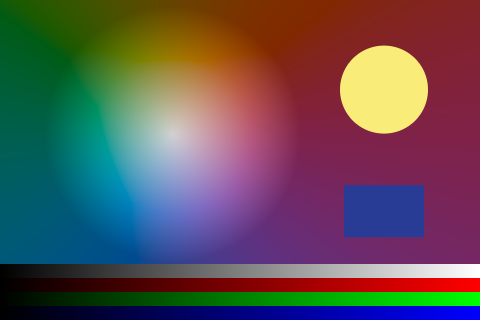 | 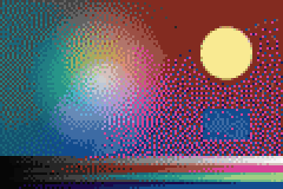 | 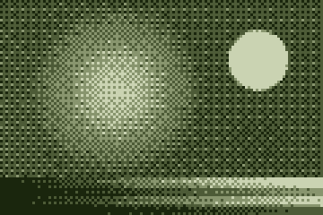 | 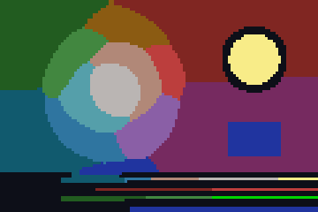 |
| The source, 480 × 320 true colour | 120 × 80, palette `sci`, Floyd–Steinberg | 120 × 80, 4 colours (`mono4`), Bayer 8 × 8 | 120 × 80, 16 colours by k-means, Sobel outline |

## Verification

```sh
python -m exactfig verify --manifest gallery/manifest.json            # warnings for changed source or re-encoded files
python -m exactfig verify --manifest gallery/manifest.json --strict   # …which then fail
python -m exactfig verify --json                                       # a machine-readable report
python -m exactfig crate --manifest gallery/manifest.json --date 2026-11-22 --license CC-BY-4.0   # RO-Crate
python -m exactfig alt --manifest gallery/manifest.json               # the exact alternative text of every file
python -m exactfig cvd --manifest gallery/manifest.json               # colour pairs colour-blind readers may confuse
```

For each entry, in order: the recipe hash and normal form, the generator and its version, the source hash, every input
file's hash, the re-run's content hash, the file on disk (decoded pixels for PNG, every frame for GIF/APNG, bytes for MIDI),
the palette lock, the file bytes (informative unless `--strict`), and finally `manifest_sha256`. A failure says what
differs: how many pixels and the first one, the first differing frame, the first differing byte, or which input changed.
Exit code 0 when everything passes. Specification: [docs/MANIFEST.md](docs/MANIFEST.md); JSON Schema:
[exactfig/provenance/manifest.schema.json](exactfig/provenance/manifest.schema.json).

**Packaging for a repository (RO-Crate).** `python -m exactfig crate --manifest gallery/manifest.json --date 2026-11-22
--license CC-BY-4.0` writes `ro-crate-metadata.json` beside the manifest, so the folder becomes an
[RO-Crate 1.3](https://www.researchobject.org/ro-crate/specification/1.3/) (the packaging WorkflowHub reads and Zenodo can archive), in the
[Process Run Crate](https://w3id.org/ro/wfrun/process/0.6) profile (provenance terms aligned with W3C PROV): every figure
and input file with its size and SHA-256, and every figure as a `CreateAction` whose instrument is its generator (name,
version, source hash), whose object is its inputs and recipe parameters, and whose result is the figure; `--author`
(a name or an ORCID URL) is recorded as the agent. Every file is read first and must have the size and SHA-256 the
manifest records, so the crate never describes a missing or changed file. It restates the manifest and adds no claim of
its own; the same manifest and files, date, licence, author and name give the same bytes.

**Alternative text, exact.** Every recorded file carries an `alt` text in the manifest, for screen readers, the `alt`
of a web page or a journal's figure description. Tools that add it afterwards can only guess what a picture shows;
exactfig writes it after the data have passed the checks the recipe states, from the checked numbers. For the gallery's
circuit: *"A Boolean circuit of 9 two-input gates on 5 inputs that outputs 1 exactly when x1 + … + x5 leaves remainder 1
on division by 3, checked on all 32 inputs; every gate leads to the output. […] 1 on 10 of the 32."* For the segmentation
comparison: *"[…] 4 true positives, 2 false positives, 2 false negatives, panoptic quality 0.4670 (exactly
21153891139/45297262530)."* Generators that check nothing get their own summary, name and size, and claim nothing more.
`python -m exactfig alt --manifest gallery/manifest.json` lists them (`--json` for a page); `verify` warns, and with
`--strict` fails, when the text this version writes differs from the recorded one; the RO-Crate uses it as each file's
description.

**SVG, with the provenance inside.** A recipe whose `output` ends in `.svg` is written as SVG instead of PNG: the same
pixels (each colour one `<path>` of rectangles, `crispEdges`, scaled by the `viewBox`, so it stays sharp at any size and
decodes to exactly the PNG's pixels and `content_sha256`), with the exact alternative text as `<title>` and `<desc>`, and
in `<metadata>` the normal-form recipe and its SHA-256, the generator's name, version and source hash, the exactfig
version and every input file's SHA-256. A reader who has only the file has what it takes to re-make it. `verify`
decodes it, compares the pixels and refuses an SVG whose embedded provenance is not the manifest's; the decoder accepts
only what exactfig writes, so an element added by hand or a changed colour fails. The gallery's
[`mod3-circuit.svg`](gallery/mod3-circuit.svg) is the circuit above, as SVG. An SVG of a raster figure is larger than its
PNG (about ten to twenty times): it is for print, slides and pages that zoom, not for saving bytes.

**Colour-blind readers.** `python -m exactfig cvd --manifest gallery/manifest.json` simulates protanopia, deuteranopia
and tritanopia (Machado, Oliveira and Fernandes 2009, full severity, in linear sRGB) on the colours each recorded image
actually uses, and reports for each vision the closest pair (OKLab distance; about 0.02 is barely visible, 0.1 clear)
and how many pairs fall below `--min` (0.06 by default). It informs and does not judge: a sequential ramp has close
neighbours by design, while colours that carry different meanings should stay apart. Run on this gallery it found two
of the four colours of the van der Waerden witness within 0.017 for a deuteranope, instance masks within 0.008, and the
0 cells of the circuit figures almost the colour of the background (0.027 for every vision). Since 0.12.0 those figures
use the ramp `cat` (the seven categorical colours of Okabe and Ito, every pair at least 0.076 apart for all four
visions) and `data.circuit` 2 colours the operations a circuit uses and draws its 0 cells, wires and inputs in greys
clear of `cat`: no pair of theirs falls below 0.06 for any vision, and a test keeps it so.

## Python API

```python
from exactfig.render import render                      # recipe dict → Rendered (bytes, content hash, size, frames)
from exactfig.data import io, field, scatter              # readers, sampling, hill-shading, contours, Delaunay
from exactfig import fmath                                # portable sin, cos, atan2, exp, log, pow, cbrt, hypot
from exactfig.forge.motion import lorenz_path, life_step  # the simulations behind the animations

out = render({"generator": "anim.life", "seed": 7, "palette": "sci", "size": [64, 48],
              "params": {"rule": "B36/S23", "frames": 60}, "output": "highlife.gif"})
open("highlife.gif", "wb").write(out.data)
tris = scatter.delaunay([0.0, 1.0, 0.0, 1.0], [0.0, 0.0, 1.0, 1.0])     # counter-clockwise index triples
```

## Numerical reproducibility

The platform's `sin`, `pow` and friends may differ in the last bit between C libraries, and C code such as `math.hypot` may be
compiled with fused multiply-add; either can move a pixel that sits on a threshold. Generators therefore call
`exactfig.fmath`, which builds `sin`, `cos`, `atan`, `atan2`, `exp`, `log`, `log2`, `pow`, `cbrt`, `hypot` and distances from
`+ − × ÷` and `sqrt` only, all correctly rounded by IEEE 754, after fdlibm. Accuracy against the platform library: within
1 ulp for sin, cos, atan, atan2, exp, log and log2; 2 ulp for cbrt; pow relative error below 2·10⁻¹⁴. Arguments beyond the
exact range reduction are refused, never silently wrong. The tests pin fmath results as bit patterns and fail if package code
calls the platform's transcendental functions or `**` on floats. The Delaunay predicates are exact (integer arithmetic), and
numbers in input files are parsed by Python's correctly rounded `float`. The gallery reproduces exactly on x86-64 and ARM64,
on two operating systems.

## When something goes wrong

exactfig never answers a mistake with a Python traceback. Every refusal is one line, `exactfig: what and why`, and the
exit code says what kind of problem it was:

| Exit code | Meaning |
|---|---|
| 0 | done (for `verify`: everything reproduced exactly) |
| 1 | `verify` found an asset that does not reproduce; the report says which and how |
| 2 | your input or your environment was refused (a recipe, a data file, a path, a missing tool) |
| 3 | an internal error: a bug in exactfig, not in your input. Run again with `EXACTFIG_DEBUG=1` for the traceback and report it |
| 130 | interrupted (Ctrl+C) |

What usually happens, and what to do:

| You see | Why | Do |
|---|---|---|
| `not UTF-8 text (byte …)` | the file was saved in another encoding (Latin-1, Windows-1252) | save it as UTF-8. A UTF-8 BOM (Notepad) and UTF-16 with a BOM (`>` in Windows PowerShell 5) are read as they are |
| `'1,5' is not a number (decimal commas …)` | decimal commas, as spreadsheets write them in many countries | export with a decimal point |
| `input '…' changed: sha256 …` | the data file is not the one the recipe pinned | if the new data is intended, record the recipe again; if not, restore the file |
| `output '../x.png' must … stay inside its folder` | an output name that would write elsewhere (a recipe from someone else cannot overwrite your files) | use a plain relative name |
| `output 'x.bmp': an image is written as .png` | the extension does not match what is written | images `.png`; animations `.gif`, `.png` or `.apng`; MIDI `.mid` |
| `… frames of … is more than 64000000 pixels` / `… cell-steps` | the animation or simulation would be too large or run for hours; refused before computing anything | fewer frames, a smaller size or scale, fewer steps per frame |
| `no such manifest` / `not in …manifest.json` | `verify` was given a path that does not exist | check the path: verifying nothing is never reported as a pass |
| `damaged PNG …` / `truncated PNG …` | the picture is cut off or corrupted | export it again |
| `generator source changed since recording` | the code of a generator differs from the code that made the asset | a warning; with `--strict` a failure. Re-record if the change is intended |
| `ffmpeg is not installed` | `video` needs FFmpeg | install it, or share the GIF/APNG, which `verify` can check |

**Where it runs.** Python 3.10 or newer, standard library only, on Linux, macOS and Windows (all three in continuous
integration, with Python 3.10 to 3.14), on x86-64 and ARM64 with the same bits; `exactfig selftest` checks a
machine in seconds. Paths with spaces and accents work; the Windows console is switched to UTF-8 for the messages.
exactfig never touches the network.

**How this is tested.** [`tests/misuse_bench.py`](tests/misuse_bench.py) runs the command line, one process per case, on
more than 110 mistakes a user can actually make (wrong encodings, truncated and corrupted files, absurd sizes, paths that
try to leave their folder, broken manifests, a missing FFmpeg, …) and fails if any case ends in a traceback, a hang, a
silent success, or a refusal without a message. It runs with the test suite.

## Limits

- **Speed.** Pure Python: a 256 × 256 field renders in one to two seconds; the gallery animations take seconds to a minute.
  Sizes are capped (2048 px per side for data figures, 1000 frames and 64 million pixels per animation).
- **PNG and GIF compression** may differ between implementations; `verify` compares decoded pixels and treats file bytes as
  informative unless `--strict`.
- **MP4** is for sharing only (lossy).
- **Cherry-picking is allowed.** Choosing the nicest seed is curation, and the seed is in the recipe.

## Architecture

```
exactfig/
  fmath.py       portable transcendental functions (fdlibm algorithms, basic IEEE 754 operations only)
  data/          io (readers of every input format: grids, points, images, catalogues, colourings, instances,
                 triangles, b-files, Pratt certificates, LRAT proofs, circuits), field (sampling, hill-shading,
                 marching squares), scatter (exact Delaunay)
  pixel/         pxmath (dithering, noise, Worley, automata, fractals, Bézier, Bresenham, SDFs, Poisson disc), palettes
                 (OKLab), palette-locked quantisation, Canvas of palette indices, PNG, SVG and GIF/APNG writers and readers
  forge/         generators: datavis (data.field, data.scatter, data.image), catalog, coloring, refutation, instances,
                 sequence, bits, triangle, pratt, circuit, circuit_refutation, sandpile (the data.* that check before they
                 draw), motion (anim.*), mathviz (math.*), annotate (draw.annotate), tiles, flora, skies, icons, sprites;
                 describe (the exact alternative text of each figure)
  music/         sequences, harmony (Viterbi), voice leading, composer, Standard MIDI File writer
  provenance/    record, verify, manifest JSON Schema, crate (RO-Crate export)
  registry.py    the generators, their versions and closed parameter schemas
  render.py      recipe → normal form → output
  cli.py         the command line; selftest.py the machine check; rng.py the seeded generator
lean/            Lean 4 proofs and programs whose outputs exactfig draws and cross-checks
examples/        recipes and the code that makes the example datasets
gallery/         the recorded outputs, their data and manifest.json
```

The core (everything that computes a figure) is pure and the shell (files, command line, manifest) is thin; a test
enforces it. See [docs/ARCHITECTURE.md](docs/ARCHITECTURE.md) for the layers, the invariants and how to add a generator.

## References

- B. E. Bayer, *An optimum method for two-level rendition of continuous-tone pictures*, IEEE ICC, 1973.
- R. W. Floyd, L. Steinberg, *An adaptive algorithm for spatial greyscale*, Proc. SID 17(2), 1976.
- B. K. P. Horn, *Hill shading and the reflectance map*, Proc. IEEE 69(1), 1981.
- C. L. Lawson, *Software for C¹ surface interpolation*, in Mathematical Software III, 1977.
- R. Franke, *A critical comparison of some methods for interpolation of scattered data*, NPS-53-79-003, 1979.
- J. H. Halton, *On the efficiency of certain quasi-random sequences of points*, Numer. Math. 2, 1960.
- J. R. Shewchuk, *Adaptive precision floating-point arithmetic and fast robust geometric predicates*, DCG 18, 1997.
- E. N. Lorenz, *Deterministic nonperiodic flow*, J. Atmos. Sci. 20, 1963.
- M. Gardner, *The fantastic combinations of John Conway's new solitaire game "life"*, Sci. Am. 223, 1970.
- R. Courant, K. Friedrichs, H. Lewy, *Über die partiellen Differenzengleichungen der mathematischen Physik*, Math. Ann. 100, 1928.
- S. Worley, *A cellular texture basis function*, SIGGRAPH 1996.
- R. Bridson, *Fast Poisson disk sampling in arbitrary dimensions*, SIGGRAPH sketches, 2007.
- A. Lindenmayer, *Mathematical models for cellular interactions in development*, J. Theor. Biol. 18, 1968.
- H. Vogel, *A better way to construct the sunflower head*, Math. Biosci. 44, 1979.
- B. Ottosson, *A perceptual color space for image processing* (OKLab), 2020.
- E. Wegert, *Visual Complex Functions: An Introduction with Phase Portraits*, Birkhäuser, 2012.
- R. M. May, *Simple mathematical models with very complicated dynamics*, Nature 261, 1976.
- M. L. Stein, S. M. Ulam, M. B. Wells, *A visual display of some properties of the distribution of primes*, Amer. Math.
  Monthly 71, 1964.
- G. Marsaglia, *Xorshift RNGs*, J. Stat. Softw. 8(14), 2003.
- L. de Moura, S. Ullrich, *The Lean 4 theorem prover and programming language*, CADE 28, 2021.
- J. E. Bresenham, *Algorithm for computer control of a digital plotter*, IBM Syst. J. 4(1), 1965. doi:10.1147/sj.41.0025.
- A. J. Viterbi, *Error bounds for convolutional codes and an asymptotically optimum decoding algorithm*, IEEE Trans.
  Inf. Theory 13(2), 1967. doi:10.1109/TIT.1967.1054010.
- P. Heckbert, *Color image quantization for frame buffer display*, Comput. Graph. 16(3) (SIGGRAPH), 1982.
  doi:10.1145/965145.801294.
- S. P. Lloyd, *Least squares quantization in PCM*, IEEE Trans. Inf. Theory 28(2), 1982. doi:10.1109/TIT.1982.1056489.
- P. Bak, C. Tang, K. Wiesenfeld, *Self-organized criticality: an explanation of the 1/f noise*, Phys. Rev. Lett. 59,
  1987. doi:10.1103/PhysRevLett.59.381.
- A. Chenciner, R. Montgomery, *A remarkable periodic solution of the three-body problem in the case of equal masses*,
  Ann. of Math. 152, 2000. doi:10.2307/2661357. C. Simó, *Dynamical properties of the figure eight solution of the
  three-body problem*, Contemp. Math. 292, 2002. doi:10.1090/conm/292/04926.
- A. Klebanoff, *π in the Mandelbrot set*, Fractals 9(4), 2001. doi:10.1142/S0218348X01000828 — the published account
  of D. Boll's 1991 observation, which Boll himself never published formally.
- D. Tymoczko, *The geometry of musical chords*, Science 313, 2006. doi:10.1126/science.1126287.
- Sun Microsystems, *fdlibm*, 1993. CompuServe, *Graphics Interchange Format 89a*, 1990. *APNG specification*, Mozilla.
  *Netpbm PGM format*. *NumPy NEP 1: a simple file format for NumPy arrays*.

## Citing

[CITATION.cff](CITATION.cff) gives the citation; GitHub shows it as "Cite this repository". When a publication uses an
exactfig figure, publish the figure's manifest (or its `manifest_sha256`) with it: that is what lets a reader check it.
Changes by version: [CHANGELOG.md](CHANGELOG.md).

## Contributing, security, licence

See [CONTRIBUTING.md](CONTRIBUTING.md) and [SECURITY.md](SECURITY.md). Licence: [Apache License 2.0](LICENSE). Two data files in the gallery come from another repository under the MIT licence, as their headers say: `gallery/data/b175001.txt` and `gallery/data/A175001-n14.txt`.
